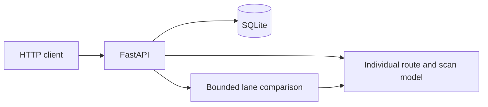

# Phase 1: corridor simulation and lane optimization

Date: 2026-11-07
Status: Approved
Scope: A local, complete corridor workflow within one 60-minute execution window.
Repos: opsidio/opsidio; product root `api/algorithm/`.
Jira: None. Retain the recorded no-Jira exception.

## Problem

The [previous design](2026-11-07-simulation-and-optimization-design.md) requires the complete service, three engines, advanced optimization, OpenAI, and lab tools.
The [execution plan](../plans/2026-11-07-simulation-and-optimization/00-overview.md) requires that scope from scratch before delivery.
The [readiness check](../plans/2026-11-07-simulation-and-optimization/readiness-check.md) identifies timing feasibility as its only remaining implementation-start blocker.

The service folder contains only the approved contract. No service implementation or executable product E2E suite exists.
Removing the timing gate alone would leave the same large implementation scope.

Deliver the product through multiple phases. This specification defines phase 1 only.
Phase 1 must work without code from later phases or a separate preparation project.

## Goals

- Create and read a saved corridor plan through HTTP.
- Compute individual walking, scan queues, admissions, and costs from that plan.
- Compare feasible additional scan lanes using the same model and fixed demand.
- Save the baseline, any improving candidate, and their measured results.
- Prove the complete workflow through HTTP E2E checks and a process restart.
- Include setup, implementation, test authoring, test runtime, fixes, and reporting within 60 elapsed minutes.
- Implement from scratch using normal dependencies and the standard library.

## Non-goals

Phase 1 excludes the full schema `0.1` document, the 26-operation API, partial editing, presets, and legacy compatibility.
It excludes genuine flow, DES, and complete spatial ABM engines from the previous design.
The corridor model has no collision avoidance, congestion response, groups, queue switching, rerouting, or exception branches.
It has no categories, accessibility rules, opening schedules, shifts, overtime, lockers, or separate admission service.

It excludes stochastic replications, run caches, background jobs, cancellation endpoints, process pools, and method registries.
It excludes other optimization levers, finalist verification, production recommendations, OpenAI calls, and lab tooling.
It excludes frontend work, Docker acceptance, deployment, surveyed geometry, and venue calibration.

These capabilities remain later-phase work. They are neither phase 1 acceptance requirements nor hidden dependencies.

## Decision

### Confirmed user decisions

| Question | Decision |
| --- | --- |
| Q1 | Reduce delivery scope to fit the hour. |
| Q2 | Write implementation from scratch; do not copy or adapt the existing source implementation. |
| Q3 | Count total elapsed execution time, including setup and test runtime. |
| Q4 | Split delivery into multiple phases; this new specification covers phase 1. |
| Q5 | Phase 1 delivers the corridor HTTP workflow and scan-lane comparison. |
| Q6 | Use a compact `/v3` contract; defer full PlanDocument compatibility and preserve `/v2` as a reference. |

The user approved this written design on 2026-11-07 and instructed the agent to stop after recording approval.

### Author choices

Use deterministic arrivals, constant walking speed, constant scan service, one FCFS queue, and synchronous bounded requests.
Use FastAPI, Pydantic, SQLite, uv, Python 3.12, and a small HTTP E2E harness.
Represent money with decimal strings and currency `IDR`, following the product API rules.
Make `/health` public. Require `X-API-Key` for every `/v3` operation.

These choices reduce implementation and verification work. The written design approval includes these author choices.

### Precedence and start conditions

For phase 1, this document replaces the previous design's full-scope requirement, coding-only clock, and feasibility-before-start gate.
The previous source requirements, A01–A17 acceptance suite, interfaces, and sandbox gates do not apply transitively to phase 1.
They remain references for later phases. Existing approvals do not establish that phase 1 is implemented or accepted.

This document defines the proposed operations and payloads for contract review.
Approval of this document includes that exact API surface. A matching OpenAPI file needs no second approval round before route implementation.
Write and lint that contract during execution, before writing its handlers. Stop for approval if a material contract change becomes necessary.

Do not require calibration, grounded duration measurements, new editor approval, a fixture-freeze project, Docker, credentials, or paid services before starting.
Perform environment checks, dependency setup, contract authoring, fixture creation, and interface wiring inside the execution hour.
Use the tools already available on Mac B. This requirement does not promise execution on an arbitrary unconfigured machine.

The existing full-scope execution plan remains blocked and unchanged. A phase 1 execution must explicitly select this specification.
Do not execute the old task unchanged or treat its checklist as phase 1 scope.

## Design

### 1. Phase boundaries

| Phase | Independently usable result | Deferred capabilities it adds |
| --- | --- | --- |
| 1 | Saved corridor plans, computed runs, and feasible lane comparisons over HTTP | Only the scope defined here; one-hour execution limit. |
| 2 | Broader event-entry plans and service reports | Full document compatibility, editing, presets, flow/DES, eligibility, service exceptions, schedules, and resource rules. |
| 3 | Complete spatial visitor simulation | Navigation graph, placements, heterogeneous visitors, collision avoidance, congestion, groups, queue choice, and rerouting. |
| 4 | Broader optimization service | ABM scoring/verification, additional levers and methods, durable jobs, recovery, cancellation, reuse, and model proposals. |
| 5 | Offline evaluation and operational packaging | Lab generation, benchmarks, isolation, discovery, promotion evidence, and deployment packaging. |

Later phases extend a working predecessor. Each needs its own design and acceptance criteria.
Their order is a roadmap, not an execution plan or a promise of one-hour delivery per phase.
Future specs decide compatibility and API versions before exposing their additional capabilities.

### 2. Components

Use one application process and one local SQLite database. No worker or container is needed.



Keep the service in `api/algorithm/api/`. Four small modules are sufficient: models, engine, store, and application.
The engine owns both simulation and the single-lever search. Avoid a framework or plugin system.
Keep the launcher, contract, dependencies, examples, and tests inside the service folder.

At execution start, preserve the current contract byte-for-byte as `docs/specs/references/2026-11-07-v2-full-scope.openapi.yaml`.
Then write phase 1 OpenAPI 3.1, version `3.0.0`, at `api/openapi.yaml`.
Keep the existing root symlink pointing to that service contract.
The previous fixture manifests describe the historical v2 freeze; do not refresh them to imply phase 1 compatibility.

### 3. Domain terms

Use [the product glossary](../../CONTEXT.md) for Plan, Run, Optimization, and Candidate.
Keep these new feature terms here until another feature needs them.

**Corridor model:** The deterministic model of individual visitors walking one declared path and sharing a scan queue.

**Scan lane:** One scan server that consumes one staff member, one scanner, and one declared physical slot.

**Lane comparison:** An optimization that evaluates the starting lane count and feasible higher lane counts without changing other inputs.

The model identifier is `corridor_v1`. Do not label it `abm`, `flow`, or `des`.
It does not implement the complete behavior associated with those methods in the previous design.

### 4. Compact plan

Accept complete plans only. Reject unknown fields and unsupported schema versions with field-level 422 errors.
The following example defines the input fields. Every field is required.

```json
{
  "schema_version": "corridor-1",
  "name": "Synthetic two-visitor scan",
  "geometry_revision": "synthetic-corridor-v1",
  "route": {
    "nodes": [
      {"id": "arrival", "position": {"x": 0, "y": 0, "z": 0}},
      {"id": "scan", "position": {"x": 3, "y": 0, "z": 4}},
      {"id": "admission", "position": {"x": 3, "y": 0, "z": 4}}
    ],
    "scan_node_id": "scan"
  },
  "arrivals": {"count": 2, "start_seconds": 0, "end_seconds": 0},
  "walking_speed_mps": 1,
  "scan": {
    "lanes": 1,
    "physical_slots": 2,
    "available_staff": 2,
    "available_scanners": 2,
    "service_seconds": 10,
    "staff_cost_per_lane": {"amount": "100.00", "currency": "IDR"},
    "scanner_cost_per_lane": {"amount": "50.00", "currency": "IDR"}
  },
  "targets": {"max_peak_scan_queue": 0},
  "budget": {"amount": "300.00", "currency": "IDR"},
  "horizon_seconds": 30
}
```

Nodes form one ordered, directed polyline in metres: first node is arrival; last node is admission.
Require 3–32 nodes with unique IDs and finite coordinates. The scan node must occur once, strictly inside the path.
Require equal Y coordinates. Consecutive nodes may share coordinates; reject elevation changes.
The submitted polyline declares a walkable route. Phase 1 does not infer obstacle clearance or validate corridor intersections.

Require 1–500 synthetic visitors, positive speed, and nonnegative scan service time.
Require `0 <= start_seconds <= end_seconds <= horizon_seconds <= 86400`, with a positive horizon.
For `n` visitors, visitor `i` arrives at `start + i * (end - start) / n`, for `i = 0..n-1`.
Equal start/end values mean simultaneous arrivals. Accept no personal visitor or ticket records.

Require 1–8 active lanes and integer resource capacities from 0–8.
Reject a starting lane count that exceeds slots, available staff, or available scanners.
Availability means the resources remaining for this corridor throughout the modeled window; phase 1 does not calculate shifts or other allocations.
Physical slots are an input capacity assumption, not a verified geometric fit.

Require a nonnegative integer queue target. Money has nonnegative decimal-string amounts with two fractional digits and currency `IDR`.
Use exact decimal or integer minor-unit arithmetic. Reject a starting plan whose active-lane cost exceeds its budget.
Each active lane incurs its staff and scanner cost once for the whole modeled window. Unused inventory incurs no cost in this model.

### 5. Individual simulation

Compute path distance by summing Euclidean lengths of consecutive segments. Split it before and after the scan node.
Each visitor walks at the configured speed. Movement has no crowd interactions or random draws.
Track arrival, walking, queue entry, service start/end, and admission times for each synthetic visitor internally.
An event schedule is sufficient; movement ticks and exported individual traces are unnecessary.

Use one FCFS queue for identical parallel scan lanes. Resolve visitor ties by synthetic index and lane ties by lane index.
Service starts at the later of queue arrival and the earliest lane availability. Release the lane at service completion.
Admission occurs after the final walking leg. The admission node adds no service queue or delay.

At equal timestamps, release completed service before assigning waiting or newly arriving visitors.
An immediately served visitor contributes zero queue wait and no peak-queue increment.
Measure queue occupancy over half-open intervals from queue entry to service start, excluding visitors in service.

Report state at the horizon. Admission at exactly the horizon counts as admitted.
Conserve visitors: admitted plus unfinished equals the configured count.
Classify unfinished visitors as walking to scan, queued, scanning, or walking to admission.
Never count a scheduled admission after the horizon as completed.

### 6. Results and identity

| Output field | Definition |
| --- | --- |
| `population.total`, `admitted`, `unfinished` | Counts at the horizon, with unfinished state counts. |
| `walking.route_distance_m` | Whole declared path length per visitor. |
| `walking.free_flow_seconds_per_visitor` | Whole path length divided by speed. |
| `walking.total_observed_seconds` | Actual walking time accumulated by all visitors through the horizon; exclude queues and service. |
| `scan.lanes`, `peak_queue` | Active lanes and peak waiting population through the horizon. |
| `scan.wait_p90_seconds`, `wait_sample_count` | Nearest-rank P90 of waits for visitors who started service by the horizon; include zero waits. Null P90 when there are no samples. |
| `costs.staff`, `equipment`, `total` | Money objects computed from active lanes and per-lane costs. |
| `checks.queue_target_met`, `budget_met`, `all_admitted` | Exact comparisons against the submitted target, budget, and population. |

Every Run contains `id`, `plan_id`, `snapshot_hash`, `created_at`, `model_id`, `engine_version`, `output`, and `limitations`.
Use UTC RFC 3339 resource timestamps. Model times remain elapsed seconds, rather than event-local clock strings.
Hash the complete validated plan using canonical JSON. Record `model_id: corridor_v1` and the engine version.
Return explicit limitations: synthetic inputs, deterministic arrivals/service, fixed route, assumed slot capacity, and absent crowd/service behaviors.
Do not claim gate P90, surveyed GBK readiness, stochastic confidence, or complete source reports.

### 7. Lane optimization

Evaluate the current lane count, then every higher integer count up to the minimum resource capacity and the eight-lane limit.
Skip counts above budget. Keep geometry, arrivals, service time, resource inventories, unit costs, horizon, and target unchanged.
Run the same corridor model for every evaluation; no constant, example-backed, or approximate scores are allowed.

Minimize this tuple lexicographically:

`(unfinished_visitors, max(0, peak_scan_queue - queue_target), total_cost_minor_units)`

Resolve exact ties by fewer lanes. Save a Candidate only when its completed score strictly improves on the completed baseline.
Its parent is the starting plan. Its only document change is `scan.lanes`.
Return `improved: false` and a null candidate when no strict improvement exists.
This comparison is not a production Recommendation or the previous design's verified finalist selection.

An Optimization contains `id`, `plan_id`, `created_at`, `baseline_run_id`, `best_run_id`, `candidate_plan_id`, `improved`, and `stop_reason`.
Its `evaluations` list records completed lane counts and score tuples; counts excluded by budget are also identified.
Persist full Runs for the baseline and the improving best candidate. Other evaluated states need only their score records.
Use `stop_reason: completed` after exhausting feasible counts, or `time_limit` after preserving the best completed comparison.
Never describe an interrupted search as exhaustive.

### 8. HTTP surface and persistence

| Method and path | Operation ID | Behavior |
| --- | --- | --- |
| `GET /health` | `getHealth` | Public 200 with `{"status":"ok"}`. |
| `POST /v3/plans` | `createCorridorPlan` | Validate and save a complete plan; return 201 with ID, parent ID, document, hash, and timestamp. |
| `GET /v3/plans/{plan_id}` | `getCorridorPlan` | Return that saved plan, including candidate plans. |
| `POST /v3/plans/{plan_id}/simulate` | `simulateCorridorPlan` | Accept `{}`; synchronously compute and save a Run; return 200. |
| `GET /v3/runs/{run_id}` | `getCorridorRun` | Return the saved Run. |
| `POST /v3/plans/{plan_id}/optimize` | `optimizeCorridorPlan` | Accept `{}`; synchronously save and return the Optimization; return 200. |
| `GET /v3/optimizations/{optimization_id}` | `getCorridorOptimization` | Return the saved Optimization and its result references. |

Do not expose unimplemented v2 routes. Saved plans are immutable; submit a new document to compare an independent edit.
Return 401 for missing/wrong API keys, 404 for missing resources, 409 for conflicting idempotency reuse, 413 for oversized bodies, and 422 for invalid input.
Use the shared `{"error":{"code":"...","message":"..."}}` envelope; validation adds field-level `details`.
Disable interactive docs and generated OpenAPI routes. Compare API keys with `secrets.compare_digest`; never log keys or request documents.
Keep JSON bodies below 1 MiB and use parameterized SQLite statements.

Accept optional `Idempotency-Key` on all POST operations. Scope keys by operation and target resource for 24 hours.
Hash the submitted JSON before defaults. Replay the saved status/body for identical content; return 409 for changed content.
Recheck idempotency after acquiring the mutation lock. Commit persisted results and their idempotency response in one short transaction.
No automatic run reuse is required without an idempotency key.

Use SQLite WAL, foreign keys, and a five-second busy timeout. Store plans, Runs, Optimizations, and idempotency responses.
Serialize POST work within the single app process; keep read handlers available.
Return 429 `service_busy` with `Retry-After: 1` for a concurrent POST. There is no accepted job queue.
Bound a simulation to two seconds and a complete optimization to ten seconds, checking the deadline during visitor/candidate processing.
Return 503 `computation_timeout` if a simulation or baseline cannot finish. Persist no incomplete result.
A later optimization timeout may persist the completed baseline and best completed comparison with the explicit stop reason.
A process crash leaves no partial result or accepted job; retry the request after restart.

### 9. Acceptance through HTTP

Author one small suite under `api/tests/e2e/`. Launch the actual application with a temporary database and a local test key.
Use HTTP and process restart for assertions. Do not import engine functions, substitute computed outputs, or require external services.
Keep the whole suite bounded to 180 seconds, or the remaining execution budget when shorter.

| Check | Required evidence |
| --- | --- |
| Lifecycle and security | Public health succeeds; protected routes reject missing/wrong keys. Save/read a plan, Run, and Optimization. Disabled docs remain unavailable. |
| Exact walking | One visitor, zero scan service, and a five-metre path complete in five seconds at 1 m/s. Moving the endpoint to ten metres changes completion to ten seconds. |
| Scan queue | The compact example admits visitors at 15 and 25 seconds. Peak queue is 1; P90 scan wait is 10 seconds; cost is IDR 150.00. |
| Lane improvement | Two lanes admit both example visitors at 15 seconds. Peak queue and P90 wait are zero; cost is IDR 300.00. Save the strictly improving candidate and real Run references. |
| Limits and ties | Slot, staff, scanner, and budget limits block infeasible counts. A one-visitor case retains the cheaper baseline. No fake candidate or production recommendation appears. |
| Horizon and arrivals | Shorten the example horizon to 20 seconds: one admitted and one unfinished in service. Shift the common arrival time and observe matching admission shifts. |
| Input and replay | Invalid references, elevation changes, unknown fields, oversized bodies, and legacy schema input reject. Identical idempotent requests replay; changed content conflicts. |
| Persistence | Restart the process and read the same documents, results, comparison references, and idempotency response from SQLite. |

Repeat equal inputs to compare computed outputs, excluding resource IDs, timestamps, and runtime metadata.
Check population conservation, cost arithmetic, target comparisons, and candidate-only lane changes in these same journeys.
Do not inherit A01–A17 or claim that these checks establish later-phase behavior.

### 10. Execution window

Start one monotonic elapsed clock when phase 1 execution begins, before environment checks or implementation reasoning.
Count all setup, code, executable tests, coordination, test runtime, fixes, and reporting. Never pause or restart that clock.
Any workers share the same deadline. Allow no more than three builders plus a coordinator; the execution plan must assign separate files.

| Elapsed window | Budget purpose |
| --- | --- |
| 0–5 minutes | Inspect the checkout, start dependency setup, and author the compact contract. |
| 5–30 minutes | Implement the bounded model, persistence, HTTP operations, and executable E2E journeys. |
| 30–50 minutes | Integrate, run the complete journeys, and correct failures. |
| 50–57 minutes | Run final acceptance, contract lint, and startup/restart checks. |
| 57–60 minutes | Stop owned processes and record results, elapsed time, and any unfinished work. |

These are budget allocations, not measured implementation estimates. They establish no feasibility prerequisite.
Use cached/local dependencies where available. Setup consumes the same budget and requires no advance installation task.
Do not start a child process whose timeout exceeds the remaining window. Terminate owned processes before the deadline.
Stop adding features by minute 50. Do not extend the hour for a test, review, commit, or handoff.

The phase 1 execution plan must include these final commands from the service folder:

```text
uv sync --locked
uv run pytest tests/e2e -q
npx --offline --yes @redocly/cli@2 lint --skip-rule info-license openapi.yaml
```

Create the package manifest, lockfile, compact example, and README during execution. The README must provide a complete local startup command.
The E2E process must use a temporary database and test key without requesting owner credentials.
Require exit 0 for acceptance and contract lint, with no contract warnings. Record any existing tool-version warning separately.
No Docker build, benchmark, live-model call, or deploy is required for phase 1 acceptance.

Complete phase 1 only when every listed output and acceptance check passes within 60 total elapsed minutes.
If time expires, stop and report `incomplete`, the observed duration, and the remaining work. Preserve evidence and working files.
Do not silently reduce this scope again, mark missing checks as passed, or require a calibration project before attempting execution.
An actual execution blocker stops work under the global rules; it does not authorize an unreviewed workaround or extra time.

## Risks

| Risk | Consequence and control |
| --- | --- |
| The hour is still unmeasured | This smaller scope supports a bounded attempt. Only a successful timed run establishes completion within the hour. |
| Simplified movement overstates capacity | Identify the corridor model and its limitations in every Run; do not present it as complete ABM or calibrated GBK evidence. |
| Compact v3 breaks documentary integration expectations | Keep the v2 reference and publish a phase-specific example/README. Current checkout has no application API callers. |
| Cold setup consumes the budget | Run setup inside the clock, use available caches, and report an incomplete result if required tooling fails. |
| Synchronous execution limits throughput | Cap visitors, nodes, lanes, request time, and concurrent POST work. Add durable concurrency only in a later phase. |

## Alternatives considered

- Remove R5 but retain full scope: rejected because it removes a start barrier without reducing implementation work.
- Reuse the existing source implementation: rejected by the user in Q2.
- Complete all phases within one hour: rejected as the delivery boundary; this specification limits only phase 1 to one hour.
- Preserve the full v2 document in phase 1: deferred by Q6; it would restore extensive validation and compatibility obligations.
- Call the corridor model complete ABM: rejected because required crowd interactions and service behaviors are absent.
- Return example outputs or analytical capacity alone: rejected because phase 1 must compute individual walking and queue outcomes.
- Require Docker or model credentials before execution: unnecessary for the approved phase 1 workflow.

## Open items

- Approve later-phase designs separately. No later-phase duration, API surface, or implementation is approved here.
- Measure phase 1 completion during execution. There is no outstanding R5-style preparation gate for this scope.

## Sources

- [Previous full design](2026-11-07-simulation-and-optimization-design.md).
- [Previous execution overview](../plans/2026-11-07-simulation-and-optimization/00-overview.md).
- [Current full-scope readiness check](../plans/2026-11-07-simulation-and-optimization/readiness-check.md).
- [Product rules](../../AGENTS.md) and [glossary](../../CONTEXT.md).
- [Original integration expectations](../../../../docs/simulation-handoff.md).

Repository inspection confirmed the empty service baseline and absence of application API callers on 2026-11-07.
This specification creates no implementation, executable tests, deployment, paid experiment, or execution-plan revision.
