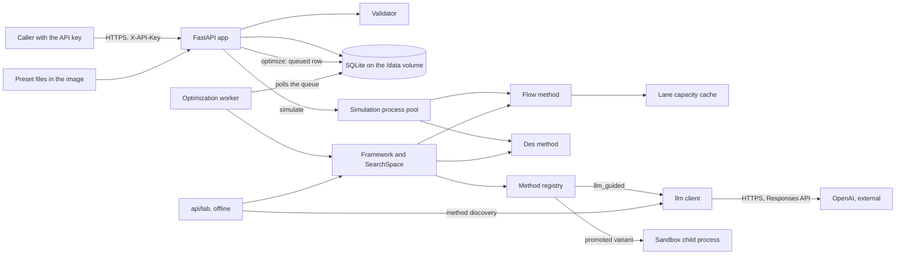
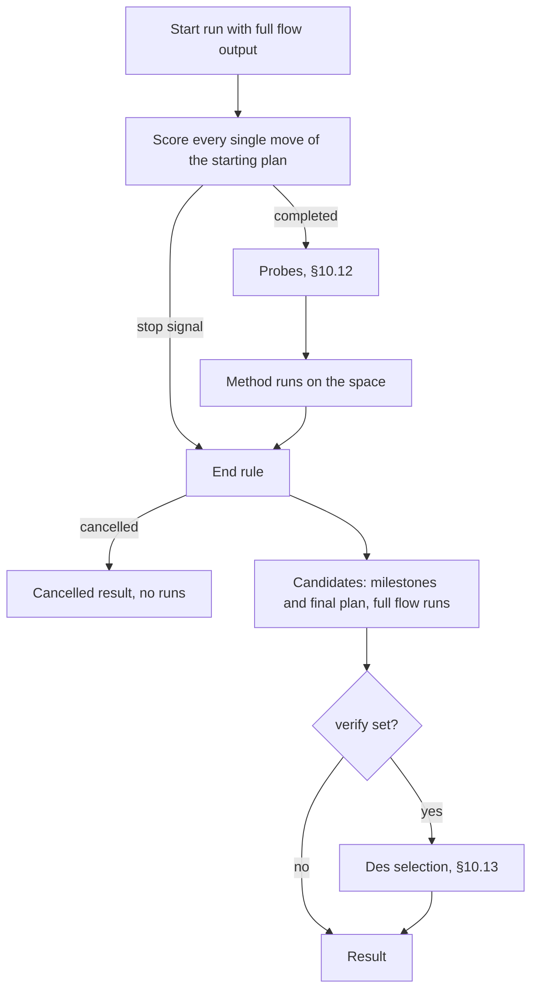

# Source simulation and optimization requirements

Date: 2026-11-07
Status: Historical reference

This local reference preserves all 18 design sections from the supplied source specification. It is not an implementation or deployment record for this repository.

The [tailored design](../2026-11-07-simulation-and-optimization-design.md) governs all differences. Its overrides apply throughout this reference, including interfaces, examples, lab code, engine names, version paths, and verification rules. The tailored design also states the applicable non-goals.

Original source SHA-256: `a392cdf6b74dfd4e8a718cc130a4a7d4bd53f7e6af9a9acc5e9e777be405f741`.

Source-relative links are rendered as reference labels because their files were not supplied. Historical measurements and provider facts require fresh verification before use.

## Design

### 1. Components



- One Railway service, `algorithm-api`, holds every component except OpenAI and the lab. OpenAI is external, and only the worker calls it. The API process makes no outbound call.
- Uvicorn runs one app process. More processes would start more optimization workers.
- A pool of `SIM_WORKERS` processes runs simulate requests. A des run then does not block other requests.
- One worker process runs one optimization at a time, from a queue in SQLite.
- Preset files ship inside the image.
- The lab imports the same framework. The image copies only `src/`, so the lab never deploys.

Code layout of the service folder `algorithm/api/`:

```text
src/algorithm_api/
├── main.py        app, key check, error handlers, start of the pool and the worker
├── routes/        one module per tag: health, presets, plans, runs, optimizations
├── documents/     Pydantic models of the plan document and the output document
├── validation/    rules across plan parts, and issue codes
├── engine/        model, lanes, capacity, flow, des, checks, rules, costs, output
├── optimize/      search space, framework, methods/, selection, sandbox, moves, hard limits, worker
├── llm/           OpenAI client, prices, ledger
├── store/         SQLite access, and migrations/
└── presets/       venues/*.json and steps/*.json
```

`api/lab/` holds the benchmark and method discovery. It is not in the image.

### 2. Plan document

A plan document has the tree of the example input file: `schema_version`, `meta`, `event`, `venue`, `process_steps`, `staff`, `constraints`, and `sources`. It can also hold the new `demand` block.

#### 2.1 Write paths

| Part | Write with |
|---|---|
| `process_steps.steps[]` | `createStep`, `updateStep`, `deleteStep`, `applyStepPreset` |
| `staff.roles[]` | `createRole`, `updateRole`, `deleteRole` |
| `venue` | `applyVenuePreset` or `updatePlan` |
| Every other part | `updatePlan` |

- `createPlan` accepts an empty object, part of a document, or a full document. A full document loads the example file in one call.
- `updatePlan` applies a JSON Merge Patch (RFC 7386) to the document. A list in the patch replaces the whole list.
- A patch that touches `process_steps.steps` or `staff.roles` gets 422 `use_item_endpoint`. Each item list has one write path.
- A new empty plan gets `schema_version: "0.1"` and `meta.document: opsidio_event_input`.

#### 2.2 Additions to the input format

| Field | Type | Purpose |
|---|---|---|
| `demand` | Optional block | Arrival windows and gate-join windows per ticket category (E-Q15) |
| `venue.known_problems[]` | List | Known problems of the venue (E-Q19). The venue preset brings them. |
| `event.ticket_categories[].zone` | Optional zone ID | Destination zone for density. Default: `zone_<category_id>`, if that zone exists. |
| `constraints.equipment.items[].extra_rented` | Optional integer, default 0 | Extra units that the plan rents. The optimizer changes it. |

Example `demand` block, with values from `derived_inputs` in the example output:

```json
{
  "demand": {
    "basis": "estimate",
    "arrival_windows_percent": {
      "festival_a": {"14:30-15:30": 25, "15:30-16:30": 35, "16:30-17:30": 25, "17:30-18:30": 10, "18:30-19:30": 5}
    },
    "gate_join_windows": {"festival_a": "after_redemption", "festival_b": "16:30-17:45"},
    "group_size_share_percent": {"1": 55, "2": 15, "3": 20, "4": 10}
  }
}
```

- A window key is `"HH:MM-HH:MM"`. The shares of one category add up to 100 ± 0.5. The engine scales them to exactly 100.
- `after_redemption` means that the visitor joins the gate queue right after redemption.
- A category without an entry uses the default curve in §5.5.
- Without `group_size_share_percent`, a visitor comes alone with the probability 1 − `arrive_in_groups_percent` ÷ 100. Otherwise, the visitor comes in a group of `typical_group_size`.

#### 2.3 Presets

- **Venue preset `tennis_indoor_senayan`.** It holds the full `venue` block of the example input, with the default lanes, plus `known_problems`. It also holds the `sources` entries that it names.
- **Step presets.** They hold the nine steps of the example input: `eticket_scan`, `ktp_name_match`, `wristband_fit`, `locker_dropoff`, `bag_check`, `body_search`, `wristband_check`, `help_desk_resolution`, and `assisted_entry`.
- Presets are read-only JSON files in `presets/`. A new preset is a code change.
- `applyVenuePreset` replaces the whole `venue` block. It adds the preset's sources to `sources`.
- `applyStepPreset` adds one step. If the plan already has a step with that ID, the call gets 409 `step_exists`.
- The API never adds a step that the caller did not ask for. The validator reports a lane step that the plan lacks.

A known problem has these fields:

```json
{
  "id": "kp_crowded_entrance",
  "past_event": "Indonesia vs China, June 2025",
  "problem": "Severe crowding at one stadium entrance. Several supporters needed oxygen.",
  "metrics": ["time_to_clear.gate_balance", "wait_time.pre_open_holding", "peak_density.open_air_exposure"],
  "linked_checks": ["chk_gate_wait", "chk_density_queue_zones"],
  "conditions": [
    {"metric": "time_to_clear.gate_balance.imbalance_index", "operator": "gt", "value": 1.5}
  ],
  "result_template": "The gate imbalance index is {time_to_clear.gate_balance.imbalance_index}. {wait_time.pre_open_holding.over_60_minutes_persons} people wait in {wait_time.pre_open_holding.zone} for more than one hour before it opens.",
  "not_covered": null,
  "sources": ["gbk_problems", "kompas_2025_pintu5"]
}
```

Condition paths:

- A path is a dot path into the output document.
- `[key=value]` selects the list items whose field `key` equals `value`.
- `[*]` selects every item. Then `aggregate` (`max`, `min`, `sum`, or `count`) makes one number of the values.
- `operator` is `gt`, `gte`, `lt`, or `lte`.
- With des, a condition compares the `mean` of a `{mean, p05, p95}` value.

Conditions in the preset are first estimates (Open item 2):

| Known problem | Linked checks | Condition for medium risk |
|---|---|---|
| `kp_outside_after_start` | `chk_inside_before_main_act`, `chk_density_queue_zones` | None |
| `kp_crowded_entrance` | `chk_gate_wait`, `chk_density_queue_zones` | `time_to_clear.gate_balance.imbalance_index` > 1.5 |
| `kp_new_check_step` | None | `max` of `arrival_and_access.scanner_outage_exposure.points[*].visitors_per_minute` > 20 |
| `kp_traffic_parking` | None | `arrival_and_access.drop_off.peak_vehicles_per_15min` > 30 |
| `kp_wristband_exchange` | `chk_redemption_wait` | `wait_time.by_point[point=redemption_tent].max_minutes` > 20 |

Risk rule (E-Q19):

- **High:** a linked check is missed.
- **Medium:** a linked check is at risk, or a condition holds.
- **Low:** none of the above.

With the values of the example output, this rule gives the same risk for all five problems.

### 3. API

#### 3.1 Conventions

- The API follows the API rules in `AGENTS.md` (original source reference): `/v1` paths, snake_case fields, camelCase `operationId` values, the error shape, cursor pagination, and the `Idempotency-Key` header.
- Two of those rules do not apply inside plan and output documents (E-Q21, ADR 0002 (original source reference)):
  - Money is an integer IDR field, such as `rate_idr_per_shift: 350000`, not a `Money` object. An integer stays exact in JSON up to 2^53.
  - A clock time is an `"HH:MM"` string in Asia/Jakarta time, not an RFC 3339 UTC time.
- Fields outside the documents follow `AGENTS.md`, for example IDs and `created_at`.
- `/health` needs the key (E-Q32). ADR 0003 (original source reference) records this exception, as `AGENTS.md` requires.
- An ID is a prefix and a ULID: `pln_`, `run_`, or `opt_`, for example `pln_01JC9W3K8Q6Y2M4T5R7V9X1Z3B`.
- Write `openapi.yaml` from this section before any route code, as `AGENTS.md` (original source reference) requires.

#### 3.2 Endpoints

| `operationId` | Method and path | Success | Notes |
|---|---|---|---|
| `getHealth` | `GET /health` | 200 | Needs the key. Returns `{"status": "ok"}`. |
| `listVenuePresets` | `GET /v1/venue-presets` | 200 | ID, name, and summary of each preset |
| `getVenuePreset` | `GET /v1/venue-presets/{preset_id}` | 200 | Full venue block |
| `listStepPresets` | `GET /v1/step-presets` | 200 | |
| `getStepPreset` | `GET /v1/step-presets/{preset_id}` | 200 | |
| `createPlan` | `POST /v1/plans` | 201 | Empty object, part of a document, or full document |
| `listPlans` | `GET /v1/plans` | 200 | |
| `getPlan` | `GET /v1/plans/{plan_id}` | 200 | Whole document |
| `updatePlan` | `PATCH /v1/plans/{plan_id}` | 200 | JSON Merge Patch |
| `deletePlan` | `DELETE /v1/plans/{plan_id}` | 204 | Also deletes the plan's runs and optimizations |
| `createStep` | `POST /v1/plans/{plan_id}/steps` | 201 | |
| `updateStep` | `PATCH /v1/plans/{plan_id}/steps/{step_id}` | 200 | Merge patch on one step |
| `deleteStep` | `DELETE /v1/plans/{plan_id}/steps/{step_id}` | 204 | |
| `createRole` | `POST /v1/plans/{plan_id}/roles` | 201 | |
| `updateRole` | `PATCH /v1/plans/{plan_id}/roles/{role_id}` | 200 | Merge patch on one role |
| `deleteRole` | `DELETE /v1/plans/{plan_id}/roles/{role_id}` | 204 | |
| `applyVenuePreset` | `POST /v1/plans/{plan_id}/apply-venue-preset` | 200 | Body `{"preset_id": "..."}`. Replaces the venue block. |
| `applyStepPreset` | `POST /v1/plans/{plan_id}/apply-step-preset` | 200 | Body `{"preset_id": "..."}`. Adds one step. |
| `validatePlan` | `POST /v1/plans/{plan_id}/validate` | 200 | Changes nothing |
| `simulatePlan` | `POST /v1/plans/{plan_id}/simulate` | 200 | Flow or des, inside the request |
| `listRuns` | `GET /v1/plans/{plan_id}/runs` | 200 | Optional `purpose` filter |
| `getRun` | `GET /v1/runs/{run_id}` | 200 | |
| `optimizePlan` | `POST /v1/plans/{plan_id}/optimize` | 202 | Queues an optimization with the chosen `optimization_method` |
| `listOptimizations` | `GET /v1/plans/{plan_id}/optimizations` | 200 | |
| `getOptimization` | `GET /v1/optimizations/{optimization_id}` | 200 | Status, progress, and result |
| `cancelOptimization` | `POST /v1/optimizations/{optimization_id}/cancel` | 200 | Stops a queued or running optimization |

- Every operation can return 401. An operation with a request body can also return 413 and 422.
- Each list accepts `limit` and `cursor`, and returns the newest items first.
- No endpoint reads one step or one role. `getPlan` returns the whole plan.
- `deletePlan` keeps the candidate plans of the plan's optimizations. They keep the old `parent_plan_id`.

#### 3.3 Resources

The plan resource:

```json
{
  "id": "pln_01JC9W3K8Q6Y2M4T5R7V9X1Z3B",
  "parent_plan_id": null,
  "optimization_id": null,
  "candidate_kind": null,
  "created_at": "2026-11-05T07:52:38Z",
  "updated_at": "2026-11-05T08:10:02Z",
  "document": {"schema_version": "0.1", "event": {}, "venue": {}, "process_steps": {}, "staff": {}, "constraints": {}}
}
```

The result of `validatePlan`:

```json
{
  "valid": false,
  "issues": [
    {"severity": "error", "code": "unknown_reference", "field": "venue.layout.gates[gate_floor].lanes[female].steps[0]", "message": "Step bag_check is not in process_steps.steps"},
    {"severity": "warning", "code": "hard_limit_broken", "field": "staff.roles[security_officer].count", "message": "Count 50 is above pool_limit_total 48"}
  ]
}
```

The body of `simulatePlan`. Every field is optional:

```json
{"simulation_method": "des", "replications": 20, "base_seed": 20261127}
```

- `simulation_method` is `flow` (default) or `des`.
- Flow always has 1 replication. Des has 20 by default, from 1 to 100.
- `base_seed` defaults to the event date as an integer, YYYYMMDD. Flow ignores it.

The run resource. The output is shortened here:

```json
{
  "id": "run_01JC9X0A1B2C3D4E5F6G7H8J9K",
  "plan_id": "pln_01JC9W3K8Q6Y2M4T5R7V9X1Z3B",
  "optimization_id": null,
  "purpose": "plain",
  "simulation_method": "des",
  "snapshot_hash": "ba21dbc1dd9eefd3683f15d4fc36e8ede76c58af9b044e0738026ef2ac07be6e",
  "reuse_key": "4287b21792950bbf19e7068a914ebd19e6245e4e9450cf8323bc918cedd44473",
  "reused": false,
  "runtime_ms": 5203,
  "created_at": "2026-11-05T07:53:10Z",
  "output": {"schema_version": "0.1", "meta": {}, "run_manifest": {}, "scorecard": {}}
}
```

`purpose` is `plain`, `start`, `probe`, `candidate`, or `verification`. Only `simulatePlan` makes plain runs.

The body of `optimizePlan` is in §10.1. The optimization resource, with values for illustration only:

```json
{
  "id": "opt_01JC9Y5N2B7C4D6F8G0H2J4K6M",
  "plan_id": "pln_01JC9W3K8Q6Y2M4T5R7V9X1Z3B",
  "status": "succeeded",
  "error": null,
  "request": {"levers": ["move_staff", "change_lanes", "open_earlier", "change_staff", "rent_equipment"], "decision_date": "2026-11-05", "max_kept_moves": 200, "time_limit_seconds": 600, "optimization_method": "greedy", "verify": {"replications": 50, "base_seed": 20261127}},
  "progress": {"rounds": 6, "runs": 288, "kept_moves": 5, "elapsed_seconds": 41.2, "best_score": {"missed_checks": 1, "shortfall": 0.02, "cost_idr": 97915000}},
  "starting_plan": {
    "snapshot_hash": "ba21dbc1dd9eefd3683f15d4fc36e8ede76c58af9b044e0738026ef2ac07be6e",
    "flow_run_id": "run_01JC9Y6A8B0C2D4E6F8G0H2J4K",
    "des_run_id": "run_01JC9Y9Z1A3B5C7D9E1F3G5H7J",
    "score": {"missed_checks": 3, "shortfall": 0.946, "cost_idr": 94195000},
    "des_checks": {"met": 5, "at_risk": 2, "missed": 3},
    "des_shortfall": 0.946
  },
  "candidates": [
    {
      "plan_id": "pln_01JC9Z1P3Q5R7S9T1V3W5X7Y9Z",
      "kind": "milestone",
      "recommended": false,
      "kept_moves": 2,
      "score": {"missed_checks": 2, "shortfall": 0.26, "cost_idr": 96665000},
      "des_checks": {"met": 7, "at_risk": 1, "missed": 2},
      "des_shortfall": 0.31,
      "flow_run_id": "run_01JC9ZA2B4C6D8E0F2G4H6J8K0",
      "des_run_id": "run_01JC9ZB3C5D7E9F1G3H5J7K9M1",
      "diff": [
        {"path": "venue.layout.gates[gate_floor].lanes[female].count", "old": 4, "new": 6, "lever": "change_lanes", "approval_needed": null},
        {"path": "staff.roles[security_officer].count", "old": 32, "new": 36, "lever": "change_staff", "approval_needed": null}
      ]
    },
    {
      "plan_id": "pln_01JC9Z2Q4R6S8T0V2W4X6Y8Z0A",
      "kind": "finalist",
      "recommended": true,
      "kept_moves": 4,
      "score": {"missed_checks": 1, "shortfall": 0.05, "cost_idr": 97415000},
      "des_checks": {"met": 9, "at_risk": 0, "missed": 1},
      "des_shortfall": 0.04,
      "flow_run_id": "run_01JC9ZC4D6E8F0G2H4J6K8M0N2",
      "des_run_id": "run_01JC9ZD5E7F9G1H3J5K7M9N1P3",
      "diff": [
        {"path": "venue.layout.gates[gate_floor].lanes[female].count", "old": 4, "new": 7, "lever": "change_lanes", "approval_needed": null}
      ]
    },
    {
      "plan_id": "pln_01JC9Z3R5S7T9V1W3X5Y7Z9A1B",
      "kind": "final",
      "recommended": false,
      "kept_moves": 5,
      "score": {"missed_checks": 1, "shortfall": 0.02, "cost_idr": 97915000},
      "des_checks": {"met": 8, "at_risk": 1, "missed": 1},
      "des_shortfall": 0.07,
      "flow_run_id": "run_01JC9ZE6F8G0H2J4K6M8N0P2Q4",
      "des_run_id": "run_01JC9ZF7G9H1J3K5M7N9P1Q3R5",
      "diff": [
        {"path": "venue.layout.gates[gate_floor].lanes[female].count", "old": 4, "new": 7, "lever": "change_lanes", "approval_needed": null}
      ]
    }
  ],
  "history": [
    {"round": 1, "move": "add_lane(gate_floor/female)", "levers": ["change_lanes", "change_staff"], "reason": null, "score_after": {"missed_checks": 3, "shortfall": 0.71, "cost_idr": 95430000}}
  ],
  "probes": [
    {"run_id": "run_01JC9Y7C9D1E3F5G7H9J1K3M5N", "change": "add_lane(gate_floor/female)", "used_by": ["bn_01"]}
  ],
  "stop_reason": "no_improving_move",
  "llm": null,
  "created_at": "2026-11-05T08:00:00Z",
  "started_at": "2026-11-05T08:00:01Z",
  "finished_at": "2026-11-05T08:00:42Z"
}
```

- `status` is `queued`, `running`, `succeeded`, `failed`, or `cancelled`.
- `error` holds `{code, message}` when the status is `failed`, for example `interrupted`.
- `kind` of a candidate is `milestone`, `final`, or `finalist`. At most one candidate is `recommended`. `llm` is null unless the method is `llm_guided`.
- `candidates[].des_shortfall` is a number or null.
- `starting_plan.des_checks` and `starting_plan.des_shortfall` are null without `verify`.
- `history[].reason` is a string or null: the reason of a kept LLM move.
- `stop_reason` is `no_improving_move`, `time_limit`, `max_kept_moves`, `scoring_budget`, or `cancelled`.
- The starting score uses the example output: 3 missed checks, with shortfalls 0.635 + 0.291 + 0.020.

`llm` holds:

- `model`, `reasoning_effort`, `fallback_rounds`, and `estimated_cost`;
- `stop_reason`: `call_limit`, `cost_cap`, `consecutive_failures`, `spend_limit`, `auth_error`, `no_key`, or null;
- `calls[]`: `round`, `status`, `request_id`, `input_tokens`, `cached_input_tokens`, `output_tokens`, `estimated_cost`, `latency_ms`, and `llm_moves[]`. Each LLM move holds `moves`, `reason`, `score` or null, and `kept`.

`estimated_cost` uses a `Money` schema, as `AGENTS.md` requires: `{"amount": "0.012345", "currency": "USD"}`, with 6 decimal places.

#### 3.4 Error codes

| Status | Code | When |
|---|---|---|
| 401 | `invalid_api_key` | The `X-API-Key` header is missing or wrong. |
| 404 | `plan_not_found`, `run_not_found`, `optimization_not_found`, `preset_not_found`, `step_not_found`, `role_not_found` | The item does not exist. |
| 409 | `step_exists`, `role_exists` | The plan already has an item with that ID. |
| 409 | `optimization_active` | `deletePlan` while an optimization of the plan is queued or running. |
| 409 | `optimization_finished` | `cancelOptimization` after the optimization ended. |
| 409 | `idempotency_key_reused` | The `Idempotency-Key` comes again with a different body. |
| 413 | `body_too_large` | The request body is larger than 1 MB (Open item 1). |
| 422 | `validation_failed` | The request fails the shape checks of §4.1. |
| 422 | `use_item_endpoint` | `updatePlan` touches `process_steps.steps` or `staff.roles`. |
| 422 | `plan_invalid` | The plan has validation errors. `details` lists them. |
| 422 | `hard_limits_broken` | `optimizePlan` on a plan that breaks hard limits. `details` lists them. |
| 422 | `optimization_method_unavailable` | `optimizePlan` with `llm_guided` while the server has no `OPENAI_API_KEY`. An unknown method gets `validation_failed`. |
| 429 | `optimization_queue_full` | Five optimizations are queued or running (Open item 1). |

#### 3.5 Compatibility

The optimization fields entered `/v1` as additions: one optional request field, new response fields, and new enum values (`AGENTS.md` (original source reference), "Versions"). `info.version` is `1.1.0`.

- The stored `request` holds the filled `optimization_method`.
- The idempotency body hash leaves unset fields out, so old keys still match.
- `optimization_resource` fills the new fields of rows stored before this change: `recommended: false`, null des fields, null `reason`, null `llm`, and `optimization_method: greedy`.
- No migration runs. `plans.candidate_kind` and the JSON columns take the new values as they are.
- `engine_version` stays. Flow and des results do not change.
- The 202 example of `optimizePlan` shows `starting_plan: null`, as the code returns.

### 4. Validation

#### 4.1 Shape on write

- The API checks the part that a request writes: types, enum values, units, and ranges.
- Examples: a percent from 0 to 100, `typical` ≤ `slow`, an `"HH:MM"` time, and an IDR amount ≥ 0.
- A bad part gets 422 `validation_failed`, with one `details` entry for each field.

#### 4.2 Rules across parts

The planner builds a plan in parts, so rules across parts wait. They run in `validatePlan` and before each run or optimization. Each issue has a severity, a code, a field path, and a message. A field path is a dot path. A list item appears as `[<key>]`, where the key is the item's `id` or `group` field, else its index.

Errors block a run:

| Code | Rule |
|---|---|
| `missing_section` | A run needs `event` (schedule, capacity, ticket categories, audience profile), `venue.layout`, `process_steps`, `staff`, and `constraints`. |
| `unknown_reference` | Each referenced ID exists. This covers steps in lanes and in `can_do`, points and lane groups in assignments, and gates in categories. It also covers shifts in roles, zones in points and gates, and the ends of walking paths. |
| `uncovered_category` | Each category has a redemption lane group, and a gate lane group for each visitor gender at its gate. |
| `no_valid_position_split` | Each lane group has a valid split of its steps over its per-lane staff (§5.3). |
| `count_mismatch` | A role's `count` equals the sum of its assignment counts. Its gender split adds up to `count`. |
| `bad_time_order` | Each point opens before it closes. `doors_open` comes before `main_act`. |
| `bad_window_total` | The demand shares of one category add up to 100 ± 0.5. |
| `missing_walking_path` | A walking path joins each pair of points that a visitor walks between. |

Warnings do not block a run:

| Code | Rule |
|---|---|
| `hard_limit_broken` | The plan breaks a hard limit of §10.3, without a simulation. Each warning names the limit. |
| `unknown_target` | A service target or safety key is not in the check catalog (§5.6). |
| `unknown_rule` | A rule ID is not in the rule catalog (§5.7). |
| `unknown_lane_staffing_key` | A `lane_staffing` key is not in the catalog of §10.3. |
| `default_demand` | A category has no demand entry, so the run uses a default curve. |

#### 4.3 Effect on runs and optimizations

| Plan state | `simulatePlan` | `optimizePlan` |
|---|---|---|
| Has errors | 422 `plan_invalid`, with the issues in `details` | 422 `plan_invalid` |
| No errors, but `hard_limit_broken` warnings | Runs. The scorecard and the quality checks report the breaks. | 422 `hard_limits_broken`, with the broken limits in `details` |
| Other warnings only | Runs | Queues the optimization |

### 5. Engine model

The flow method and the des method share this model.

#### 5.1 Attendance and visitor attributes

- A category's attendance is `sold` × (1 − `no_show_percent_estimate` ÷ 100). A complimentary category uses `issued` instead of `sold`.
- Flow uses the expected value. Des draws each ticket holder with that probability.
- Each visitor has a gender, a bag or not, a locker need or not, an accessibility need or not, and a group. The shares come from `event.audience_profile`.

#### 5.2 Visitor path

1. The visitor arrives on site. The arrival curve of the category sets the time.
2. The visitor queues at the redemption lane group that serves the category. An accessible visitor uses the lane group with `also_serves: accessible_visitors`.
3. A visitor who needs a locker goes to the locker point.
4. The visitor joins the gate queue at the gate-join time (§5.5). Nobody joins before `event.schedule.outer_area_open`.
5. An accessible visitor uses the priority gate for every category. The visitor first queues for the escort duty lane group there.
6. The visitor queues at the gate lane group for the category and the gender.
7. After the gate, the visitor enters the category's destination zone. If the gate leads to a holding zone, the visitor first stays there for 10 minutes [assumed].

Exceptions change this path (§5.4). Walking time is the distance in `walking_paths` ÷ 1.0 m/s.

#### 5.3 Lane model

1. **Per-lane staff.** An assignment with `lane_group` and `per_lane` puts that many people of the role in each lane of the group.
2. **Duty lane groups.** No per-lane role can do some lane steps, but a role on duty at the same point can. Such a step gets its own lane group, `point/duty`. Each person on that duty is one lane with one position. Only visitors to whom the step applies queue there, before the lane.
3. **Positions.** Each per-lane person works one position. The engine splits the other steps, in order, into one block per position. A block goes to a role that can do every step in it. The engine picks the valid split whose slowest position has the lowest mean time.
4. **More people than steps.** Each extra person becomes another server at the slowest position that the person's role can work (Open item 3).
5. **Duties without lane steps.** Supervisors, floaters, runners, marshals, ushers, and medical posts serve no visitors. Their cost counts.

Results for the example input:

| Lane group | Staff per lane | Positions |
|---|---|---|
| `redemption_tent/general` | 2 ticketing crew | [`eticket_scan` + `ktp_name_match`], [`wristband_fit`] |
| `gate_floor/female` | 2 security officers, 1 door crew | [`bag_check`], [`body_search`], [`wristband_check`] |
| `help_desk/desk` | 2 help desk agents | [`help_desk_resolution`] with 2 servers |
| `gate_priority/escort` | Duty: 2 accessibility escorts | 2 lanes of [`assisted_entry`] |

#### 5.4 Step times and exceptions

- A step time follows a lognormal distribution. `typical` is the median, and `slow` is the 90th percentile. So μ = ln(`typical`) and σ = ln(`slow` ÷ `typical`) ÷ 1.2816. A sample never exceeds 3 × `slow`.
- `applies_to` sets the share of visitors that a step serves: every visitor, or a share from `audience_profile`.
- An exception happens to `share_percent` of the visitors at its step. The exceptions of one step exclude each other.

| Outcome | Time that the lane spends | Next step of the visitor |
|---|---|---|
| `continue` | Step time + extra time | Next position |
| `secondary_check` | Step time + extra time | Next position |
| `step_aside_and_return` | Step time | Leaves the lane. Joins the same queue again after the extra time. |
| `help_desk` | Step time + extra time | Help desk queue |
| `locker_point` | Step time + extra time | Locker queue, then the same gate queue again |
| `redirect_to_correct_gate` | Step time + extra time | Walks to the category's gate and joins its queue |
| `back_to_redemption` | Step time + extra time | Walks to the redemption queue, then joins the gate again |
| `refuse_entry` | Step time + extra time | Leaves without entry |

- At the help desk, `resolved_percent` of the visitors continue to the locker point or the gate. The agent fits their wristband. The others are refused.
- Locker units are `available` + `extra_rented`. When every unit is in use, a locker user is turned away. That visitor needs 10–20 minutes to take the item away, as the example output assumes. Then the visitor goes to the gate.
- A lane serves only while its point is open. For a visitor who queues before the opening, the wait starts at the opening time.
- A visitor still in a redemption queue when the point closes is refused as `redemption_closed`. A visitor still in a gate queue at its close is refused as `last_entry_passed`.

#### 5.5 Demand

- A category in the `demand` block uses its own windows, with basis `estimate`. Every other category uses the default curve of its admission type, with basis `assumed`.
- Visitors arrive evenly inside each window.
- The default curves (E-Q28) move with `event.schedule.doors_open` (D) and `event.schedule.main_act` (M):

| Admission | Arrival windows and shares | Gate-join window |
|---|---|---|
| `standing` | D−150 to D−90: 8%. D−90 to D−30: 20%. D−30 to D+30: 32%. D+30 to D+90: 27%. D+90 to M: 10%. M to M+45: 3%. | D−60 to D+15 |
| `seated` | D−120 to D−60: 10%. D−60 to D: 25%. D to D+60: 33%. D+60 to M−30: 20%. M−30 to M: 8%. M to M+45: 4%. | D−45 to D+30 |

- The shapes come from `festival_b` and `cat2` in the example output. With D = 17:30 and M = 19:45, they give the same windows as that file.
- If a default window is empty, its share moves to the window before it.
- **Gate join.** Each visitor plans a join time, uniform inside the gate-join window. The visitor joins at the later of two times: the planned time, or the ready time plus 0–5 minutes. The ready time is the end of redemption, or the end of the locker drop-off.
- With `after_redemption`, the visitor joins at the ready time.
- The engine never reads free-text notes. A category with early fans, such as Festival A, needs a demand entry.

#### 5.6 Check catalog

The engine knows these targets. An unknown key gets the warning `unknown_target` and no check.

| Check ID | Source in `constraints` | Metric | Kind |
|---|---|---|---|
| `chk_redemption_wait` | `service_targets.redemption_wait` | P<share> wait at the first required point of `visitor_flow` | Maximum |
| `chk_gate_wait` | `service_targets.gate_wait` | P<share> wait at all gates | Maximum |
| `chk_longest_wait` | `service_targets.longest_acceptable_wait_minutes` | Longest wait of one visitor at one point | Maximum |
| `chk_inside_before_<moment>` | `service_targets.inside_before_<moment>_percent` | Share of the attendance inside at `event.schedule.<moment>` | Minimum |
| `chk_<category>_before_<moment>` | `service_targets.<category>_inside_before_<moment>_percent` | Share of the category's attendance inside at `event.schedule.<moment>` | Minimum |
| `chk_density_queue_zones` | `safety.max_density_persons_per_m2.queue_zones` | Highest peak density in a zone of type `queue` | Maximum |
| `chk_density_standing_floor` | `safety.max_density_persons_per_m2.standing_floor` | Highest peak density in a zone of type `standing` | Maximum |
| `chk_density_<key>` | `safety.max_density_persons_per_m2.<key>` | Peak density in the zone `zone_<key>` | Maximum |
| `chk_staff_budget` | `budget.staff_cap_idr` | Staffing cost | Maximum |
| `chk_equipment_budget` | `budget.equipment_cap_idr` | Committed equipment cost plus extra rentals | Maximum |

- `<share>` is `for_share_of_visitors_percent` of the target, for example 90.
- **Status.** A check is met when its target holds in at least 95% of the replications. It is at risk when the mean holds but more than 5% of the replications fail. It is missed when the mean fails. A flow run has one replication, so a check is met or missed.
- **Shortfall.** For a maximum, (result − target) ÷ target. For a minimum, (target − result) ÷ target. A met check has shortfall 0.

#### 5.7 Rule catalog

The engine tests the rules that it knows. Each other rule ID gets `not_tested` and the warning `unknown_rule`.

| Rule ID | Test |
|---|---|
| `rule_same_gender_search` | Each lane group with a visitor gender and a `body_search` step has only security staff of that gender. |
| `rule_certified_security` | Only roles with a `certification` work positions with `bag_check` or `body_search`. |
| `rule_id_check_all` | Each category's redemption lane group has the step `ktp_name_match`. |
| `rule_supervisor_per_gate` | Each gate has a `supervisor` duty of a role that can do `body_search`. |
| `rule_priority_gate_open` | The priority gate opens no later, and closes no earlier, than every other gate. |
| `rule_friday_prayer` | On a Friday, no shift starts, and no briefing takes place, from 11:30 to 12:45. |
| `rule_no_re_entry`, `rule_breaks`, `rule_no_break_peak` | `not_tested`. The model has no exits before the end and no break schedule. |

#### 5.8 Costs

- The shift cost of a role is people × `rate_idr_per_shift`.
- The meal cost is people × `meal_allowance_idr_per_person`, unless `meals_included_in_package` is true.
- A role with `cost_model: package` costs `package_idr`.
- Overtime starts when the last service at a role's points ends after the role's shift ends. Each person on those lanes earns `overtime_idr_per_hour` for each started hour.
- The staffing cost is the sum of shift, meal, package, and overtime costs.
- The equipment cost is the sum of `committed_cost_idr`, plus `extra_rented` × `extra_cost_idr_per_unit` for each item.

### 6. Lane capacity

- Lane capacity is the number of visitors per minute that leave the first position of a lane whose queue never empties (E-Q14).
- The engine simulates 6,000 visitors through the lane's positions. It drops the first 1,000 visitors as warm-up.
- The simulation samples step times and exceptions with the rules of §5.4. At most one visitor waits between two positions. A served visitor blocks the position until the next position has room.
- The seed is the first 8 bytes of the SHA-256 of the lane setup's canonical JSON. So a flow run gives the same result every time.
- Each process caches the capacity in memory, under that hash.
- A check during the design review simulated 200,000 visitors per lane:

| Lane | 60 ÷ mean time at the slowest position | Simulated lane, one waiting place |
|---|---:|---:|
| Gate lane, example input | 271 per hour | 188 per hour |
| Redemption lane, example input | 136 per hour | 131 per hour |

### 7. Flow method (A2)

- **Time grid.** The grid has 1-minute slots. It starts at the first arrival or the first opening of a point. It ends when every queue is empty, or at `constraints.timing.venue_slot_end`.
- **State.** Each lane group keeps two cumulative curves for each visitor class (category × gender × accessible): arrivals A(t) and service starts S(t).
- **Each minute**, in the order of `visitor_flow`:
  1. Add the amounts that reach each queue: new arrivals, walks, returns, and gate joins.
  2. Each open lane group starts service for min(queue, lanes × lane capacity) visitors.
  3. The class mix of these starts follows first come, first served. It equals the mix of the arrivals that the starts match on the cumulative curves.
  4. The started visitors leave the lane after the mean lane time. Exception shares send amounts to their outcomes, with walk and return delays.
- **Wait.** Visitors who join at minute t wait from max(t, opening time) until the first minute in which S reaches A(t). A percentile weights each minute by the amount that joins in it.
- **Density.** Persons in a zone ÷ zone area, for each minute.
- **No randomness.** A flow run has one replication. Each `{mean, p05, p95}` map holds three equal values.
- **Score-only mode.** During a search, the engine computes only the check results and the busy share of each lane group. It skips the rest of the output.
- **Fields that flow cannot give.** They are null, and `run_manifest.uncomputed_fields` lists them:
  - `wait_time.by_category[].all_queues_p90_minutes`. Flow cannot add up the waits of one visitor.
  - `peak_density.open_air_exposure.with_rain_plan_persons`. The rain plan is free text. This field is null for des too.
- In flow, a visitor who joins the same point twice counts as two joins. In des, the two waits of that visitor add up.

### 8. Des method (A3)

- Des is a per-visitor discrete-event simulation with one event queue. It uses the assumptions in `run_manifest.assumptions` of the example output:
  - Step times and exceptions follow §5.4.
  - Each person in a lane works one position. At most one visitor waits between two positions.
  - Floaters cover meal breaks, so a break never closes a lane.
  - Visitors walk at 1.0 m/s along `walking_paths`.
  - Visitors who wait for their gate-join window stand in `zone_forecourt`.
  - Each accessible visitor with a festival ticket needs one wheelchair place.
- Each lane group has one first-come, first-served queue. The first free lane takes the next visitor.
- A group arrives together and joins each queue together. Nobody leaves a queue before service.
- **Replications.** Replication i uses the seed `base_seed` + i. Each replication has two random streams: one for visitors and one for step times.
- The engine draws every random value of a visitor when it creates the visitor. Plans that differ by one move then see the same visitors (common random numbers).
- **Results.** A simulated value is the mean across the replications. A `{mean, p05, p95}` map adds the 5th and the 95th percentiles.

### 9. Output document

#### 9.1 Sections

| Section | Flow | Des | Notes |
|---|---|---|---|
| `meta` | Yes | Yes | Fixed text from the example output, with `example: false` |
| `run_manifest` | Yes | Yes | Changes in §9.2 |
| `scorecard` | Yes | Yes | Flow: met or missed only |
| `known_problem_checks` | Yes | Yes | From `venue.known_problems` |
| `time_to_clear` | Yes | Yes | |
| `max_queue_length` | Yes | Yes | |
| `wait_time` | Partly | Yes | Flow: `all_queues_p90_minutes` is null |
| `staff_utilization` | Yes | Yes | |
| `staffing_cost` | Yes | Yes | Computed. Overtime comes from the run. |
| `peak_density` | Partly | Partly | `with_rain_plan_persons` is null |
| `bottleneck_report` | Yes | Yes | `moves_to` is filled only in an optimization's start run |
| `entry_outcomes` | Yes | Yes | |
| `support_services` | Yes | Yes | |
| `stock_check` | Yes | Yes | |
| `arrival_and_access` | Yes | Yes | |

#### 9.2 Changes from the example output

- `run_manifest.plan` holds `plan_id`, `parent_plan_id`, and `plan_hash_sha256`. It replaces `file` and `parent_run_id`.
- `plan_hash_rule` says: SHA-256 of the canonical JSON of the plan document.
- Canonical JSON is `json.dumps(document, sort_keys=True, separators=(",", ":"), ensure_ascii=False)`, encoded as UTF-8.
- `run_manifest.idempotency_key` holds the reuse key of §13. `idempotency_rule` names its seven parts.
- `run_manifest.uncomputed_fields` lists the null fields of §7.
- `run_manifest.replications.base_seed` is null for flow.
- `run_manifest.derived_inputs` shows the curves that the run used, with basis `estimate` or `assumed` (E-Q15).
- `run_manifest.assumptions` lists every assumed value, including the new values in §5.
- The only text fields are `scorecard.summary`, the `result` of each known problem, and `moves_to.result`. Other `note` and `effect` fields are absent.

#### 9.3 Text templates

- `scorecard.summary`: "The plan misses {m} of {n} checks: {missed}. {k} checks are at risk: {at_risk}."
- The engine drops an empty sentence. With no missed and no at-risk check, the summary is "The plan meets all {n} checks."
- `{missed}` and `{at_risk}` list the `metric` text of the checks.
- A known problem's `result` fills the placeholders of its `result_template` from the output. A `{mean, p05, p95}` value shows its mean.
- `moves_to.result`: "{lane_group} clears at {cleared_at}. {slowest} becomes the slowest lane group. The P90 gate wait changes to {p90} minutes. The staff cost changes by Rp{delta} to Rp{total}."

### 10. Optimization

#### 10.1 Request

| Field | Default | Meaning |
|---|---|---|
| `levers` | All five | The levers that moves can use: `move_staff`, `change_lanes`, `open_earlier`, `change_staff`, and `rent_equipment`. |
| `decision_date` | Today in Asia/Jakarta | The day when the planner commits changes. Lead times count from it. |
| `max_kept_moves` | 200 | From 1 to 500 |
| `time_limit_seconds` | 600 | From 10 to 1,800 |
| `optimization_method` | `greedy` | The method of the search: a name that the registry marks selectable (§10.6). An unknown name gets 422 `validation_failed`. |
| `verify` | `{"replications": 50, "base_seed": <event date as YYYYMMDD>}` | Des selection runs after the search (§10.13). `null` skips it. `replications` goes from 1 to 100. |

- The five levers are items 1–5 of `constraints.levers.allowed_changes` (E-Q16).
- `change_staff` adds staff from a pool, or releases staff to save cost.
- The optimization works on a snapshot. The API takes it when the request arrives. Later edits to the plan do not change it.

#### 10.2 Score

The score of a plan is the tuple (missed checks, total shortfall, total cost in IDR). The lower tuple wins. The comparison goes in that order (E-Q6).

- The total cost is the staffing cost plus the equipment cost.
- A wait far below its target earns no credit.
- The search never spends `on_the_day_contingency_idr`.

#### 10.3 Hard limits

The search drops each move whose changed plan breaks one of these limits:

- The rules of the rule catalog that a move can break (§5.7).
- `pool_limit_total` and `pool_limit_by_gender` of each role.
- `max_lanes` of each point.
- The minimum and maximum staff per lane in `lane_staffing`, through this catalog:

| Key | Applies to |
|---|---|
| `redemption_counter` | Per-lane staff at the first required point of `visitor_flow` |
| `help_desk` | Per-lane staff at the point in `exceptions_go_to` |
| `locker_counter` | Per-lane staff at lanes with the step `locker_dropoff` |
| `gate_security` | Per-lane staff at gates, of roles that can do `body_search` |
| `gate_door_scan` | Per-lane staff at gates, of roles that do `wristband_check` |

- **Equipment.** Units per lane × lanes ≤ `available` + `extra_rented` ≤ `available` + `extra_rentable`.
- **Timing.** The limits `redemption_open_earliest`, `redemption_close_latest`, `doors_open_earliest`, and `last_entry_latest` in `constraints.timing`.
- **Shift cover.** A point opens no earlier than the shift start of the staff on its lanes.
- **Lead time for extra people.** `decision_date` + `extra_staff_lead_time_days` ≤ the event date. Also, `decision_date` is on or before the day in `staffing_changes.confirm_extra_crew_by`.
- **Lead time for extra equipment.** `decision_date` + `lead_time_days` ≤ the event date.
- **Budget caps.** The staffing cost without overtime ≤ `staff_cap_idr`. The equipment cost ≤ `equipment_cap_idr`. After the run, the staff cap check repeats with overtime.

#### 10.4 Moves

| Move | Change | Levers |
|---|---|---|
| `add_lane(g)` | Lane group g gets one more lane. Each per-lane role gets `per_lane` more people. `extra_rented` covers missing equipment. | `change_lanes`, `change_staff`, and `rent_equipment` when the move rents |
| `remove_lane(g)` | Lane group g loses one lane, down to 1. Each per-lane role releases `per_lane` people. | `change_lanes`, `change_staff` |
| `move_lane(g, h)` | g loses one lane, and h gets one. The people and the equipment move with it. Both groups need the same roles per lane and the same visitor gender. | `move_staff`, `change_lanes` |
| `add_staff_per_lane(g, r)` | `per_lane` of role r at g goes up by 1, for every lane of g. | `change_staff` |
| `remove_staff_per_lane(g, r)` | `per_lane` of role r at g goes down by 1. | `change_staff` |
| `open_earlier(p)` | Point p opens 15 minutes earlier. | `open_earlier` |
| `add_locker_units` | `extra_rented` of `locker_unit` goes up by 50, or by what is still rentable. | `rent_equipment` |

- New people for a lane group with a visitor gender get that gender. For other lane groups, they get the gender with more room in the pool.
- A gate that opens before `event.schedule.doors_open` sets `approval_needed` in the diff, from `constraints.timing.doors_open_earlier_needs_approval_from`.
- The search uses a move only if the request allows every lever of the move.

#### 10.5 Search space

`optimize/space.py` holds one `SearchSpace` for each optimization. A method sees plans only through it.

- A state is an integer. State 0 is the starting plan. The space keys states by snapshot hash, so two states never hold equal documents.
- A move ID is the move label of §10.4, such as `add_lane(gate_floor/female)`.
- A method never reads or changes a plan document. It may keep its own data, such as a tabu list.

| Member | Returns | Rule |
|---|---|---|
| `start`, `current`, `best` | state | `current` is the last committed state. `best` is the committed state with the lowest score. |
| `stop_reason` | `str` or `None` | `time_limit`, `cancelled`, `scoring_budget`, or `max_kept_moves`, once a stop signal fires |
| `budget_left` | `int` or `None` | `None` when the optimization has no scoring budget |
| `moves(state)` | `list[MoveInfo]` | The allowed single moves, in the fixed move order of greedy (§10.10) |
| `blocked_moves(state)` | `list[str]` | Move IDs that the levers allow but that a hard limit or the plan blocks when used alone |
| `apply(state, move_ids)` | state or `None` | Applies 1–3 moves in order. `None` when a move cannot apply, a lever is not allowed, or the final plan breaks a hard limit. |
| `score(state)` | `Score` or `None` | The cached flow score. `None` when the plan breaks the staff cap with overtime, or when a stop signal is set. |
| `view(state)` | `dict` or `None` | The plan view of §11.2. `None` when a stop signal is set. |
| `commit(state, reason=None)` | — | Makes `state` current and adds a history entry. The state needs a score. |

`MoveInfo` is a named tuple: `id`, `kind`, `levers`, and `cost_delta_idr`. `cost_delta_idr` is the change in staffing cost without overtime plus equipment cost.

- The hard limits of §10.3 apply to the final plan of a compound move. A plan between its moves may break them, but each move must apply to that plan.
- The lead-time limits compare the final plan with the starting plan, as `lead_time_breaks` does.
- A `score` call for a new state costs one scoring. A cached score costs nothing. The starting plan's score is free.
- The first `view` call for a state costs one scoring.
- The space checks the cancel flag and the clock after each scoring, and each time a method reads `stop_reason`.
- The space records each scored state, its first parent, and the compound move from that parent.

#### 10.6 Methods and the registry

- A method is a function `run(space, ctx) -> None` in its own module under `optimize/methods/`. It returns when it has nothing left to try, or when `space.stop_reason` is set.
- Each method module defines `SPEC = MethodSpec(...)`. The registry imports every module in `optimize/methods/` that defines `SPEC`. A new method never edits a shared file.

| `MethodSpec` field | Meaning |
|---|---|
| `name` | The value of `optimization_method`, in snake_case |
| `run` | The method function |
| `selectable` | True when the API accepts the method. The `OptimizationMethod` enum in `openapi.yaml` lists exactly these names. |
| `needs_openai` | True for `llm_guided` |
| `production_budget` | The scoring budget in production. `None` means no budget. |

`MethodContext` carries three fields:

- `rng`: a `random.Random` seeded from the first 16 hex digits of the snapshot hash. A method without an LLM call gives the same result for the same request.
- `llm`: the OpenAI client for a method with `needs_openai`, else `None`.
- `extras`: a dict. A method puts its own result block there, such as `llm`.

#### 10.7 Framework flow

`optimize/framework.py` runs every optimization. `run_optimization` takes the keyword `llm=None` (§12.7).



1. The framework runs the start run and the probes of §10.12. The scorings of every single move count toward the budget. Methods then get these scores from the cache.
2. The method runs until it returns or a stop signal fires.
3. **End rule.** Unless the search was cancelled, the framework checks for scored states that beat the best committed state. It commits the best of them. A tie goes to the state that the space scored first.
4. The framework builds the candidates from the kept path (§10.8). It then runs des selection when `verify` is set.

#### 10.8 Kept path, milestones, and the final plan

- An incumbent is a committed state with a lower score than every state committed before it. The starting plan is the first incumbent.
- A milestone is an incumbent with fewer missed checks than the incumbent before it.
- The final plan is the last incumbent.
- History lists the commits. Its `move` is the compound move from the previous committed state, written as labels joined by ` + `. A commit without such a move is a `jump`, with empty `levers`.
- A candidate's `kept_moves` is the number of commits up to it. Its `diff` combines the diffs of those commits with `combine_diffs`. A jump replaces the diffs before it with the diffs along the parent chain of its target.

For greedy, every commit is an incumbent, so its candidates equal those of the greedy-only search.

#### 10.9 Progress, stop reasons, and greedy parity

| `progress` field | Rule |
|---|---|
| `rounds` | The commits, plus 1 when a `score` call came after the last commit |
| `runs` | The start run, the probes, and every scoring and first view that costs budget. Cache hits are not runs. |
| `kept_moves` | The commits |
| `best_score` | The score of the best committed state |

- The framework writes `progress` after each commit.
- `stop_reason` is `no_improving_move` when the method returns without a stop signal. The other values are `time_limit`, `max_kept_moves`, `scoring_budget`, and `cancelled`. `scoring_budget` is new. The contract gives `stop_reason` no enum, so the new value is compatible.

Greedy on the seam keeps its candidates, history, probes, and stop reasons. `progress.runs` falls by the number of cache hits. One change is deliberate (O-Q14). When a stop signal cuts a round short, the end rule keeps the best improving move that greedy already scored. The greedy-only search dropped it.

#### 10.10 Optimization methods

**greedy**

```text
current ← the starting plan
while the space has no stop signal:
    moves  ← every move that the levers and the hard limits allow
    scored ← [(score(apply(current, m)), m) for each m in moves]
    drop each scored plan whose staffing cost with overtime breaks the staff cap
    (s, m) ← the lowest score in scored
    if s ≥ score(current): return
    commit apply(current, m)
```

- The framework runs the start run, scores every single move of the starting plan, and picks the probes before the method runs (§10.7).
- At a tie, the first move in a fixed move order wins. So the same request gives the same search.
- The end rule keeps the best scored improving state after a stop signal (§10.7, §10.9).
- `stop_reason` is `no_improving_move`, `time_limit`, `max_kept_moves`, `scoring_budget`, or `cancelled`.

A greedy round scores every allowed single move. It commits the move with the lowest score when that score beats the current one. The first move in the fixed order wins a tie. Other methods use the greedy round as their fallback.

`production_budget` is `None`. `selectable` is true.

**greedy_pairs**

1. Run greedy rounds while one improves the plan.
2. When none does, take the 8 single moves with the lowest scores on the current plan. Score each pair of them as a compound move: 28 pairs.
3. Commit the best pair that improves the plan, then go back to item 1.
4. Return when no pair improves the plan.

`production_budget` is `None`. `selectable` becomes true only when the method passes the acceptance rule.

**tabu_elite**

A tabu search with an elite memory, after [TESO](https://arxiv.org/html/2512.24007v1).

| Parameter | Start value |
|---|---|
| Neighbors per round | 16 allowed single moves, drawn with `ctx.rng` |
| Tabu list | The last 10 committed states |
| Elite memory | The 5 best scored states |
| Restart | After 4 rounds without a new incumbent, commit a random elite state and clear the tabu list |

- Each round commits the best neighbor that is not tabu, even when it is worse than the current plan.
- The method has no aspiration rule. A tabu state is a committed state, so it never beats the best committed state (optimization build log, 7 November 2026).
- The method runs until a stop signal fires. `production_budget` is 400.
- Tune the parameters on development plans only.
- `selectable` becomes true only when the method passes the acceptance rule.

**llm_guided**

Each round (O-Q19):

1. Read `view(current)`, `moves(current)`, and `blocked_moves(current)`.
2. Ask the model for 1–8 LLM moves. Each LLM move has 1–3 move IDs and a reason of one sentence.
3. Drop unknown move IDs. Apply and score each remaining LLM move.
4. Commit the best LLM move that improves the plan. Its reason goes into `history[].reason`, cut to 200 characters.
5. Otherwise run one greedy round. When it fails too, return.

- The first prompt includes the score of every single move of the starting plan, from the cache.
- Later prompts include every earlier LLM move, with its score and whether it was kept.
- After an LLM limit (§11.3), every later round is a greedy round without a call.
- `production_budget` is `None`. `selectable` is true from the first deploy (O-Q24).
- The result block `llm` records every call (§3.3).
- OpenAI offers no seed for current reasoning models. The same request can give another search path. This is the one exception to Goal 5 (O-Q23).

#### 10.11 Candidates

- Each milestone and the final plan become new plans (E-Q24). A candidate plan has `parent_plan_id` (the starting plan), `optimization_id`, and `candidate_kind`: `milestone`, `final`, or `finalist`. A recommended finalist that is no candidate yet becomes one (§10.13).
- If the final plan equals the last milestone, that one candidate has the kind `final`.
- An optimization saves at most one candidate per check, plus the final plan.
- Each candidate gets a full flow run, with purpose `candidate`.
- With no kept move, the optimization saves no candidate. `stop_reason` explains why.

#### 10.12 Probes

- The framework scores every single move of the starting plan before the method runs. These scorings count toward the budget (§10.7).
- For each bottleneck episode of the start run, the probe is the best-scoring move that changes the episode's lane group. That move is `add_lane`, `move_lane` into the group, `add_staff_per_lane`, or `open_earlier` of its point.
- The framework scores the single moves in score-only mode. So the engine runs each probe once more with the full output, and stores it with purpose `probe`.
- After the probes, the engine stores the start run. Its `bottleneck_report.episodes[].moves_to` is filled, and `run_manifest.probe_runs` lists the probes.
- Des runs keep `moves_to` null, because the probes are flow runs.

#### 10.13 Des selection

`optimize/selection.py` runs after the candidates when `verify` is set (O-Q10, ADR 0005 (original source reference)).

**Finalists**

- Every milestone, and the final plan.
- The incumbents between the last milestone and the final plan, at most 6. When more exist, take 6 spread evenly by commit number, with the first and the last included.
- Without a milestone, the starting plan stands in for the last milestone.

**Runs**

- One des run on the starting plan and one on each finalist. All runs use `verify.base_seed` and `verify.replications`, so they share common random numbers. Their purpose is `verification` (E-Q18).
- The default of `verify.replications` is 50.

**Des score**

- The des score of a plan is (des missed checks, des at-risk checks, des shortfall, flow `cost_idr`). The lower tuple wins.
- Des shortfall is the sum of the check shortfalls in the des output.
- Cost comes from the flow score, because des randomness barely changes it.

**Choice**

- The finalist with the lowest des score is the recommended plan when its des score is lower than the starting plan's. A tie goes to the finalist with fewer kept moves.
- If no finalist beats the starting plan, no plan is recommended.
- A recommended finalist that is not yet a candidate becomes a candidate of kind `finalist`. It gets a plan ID, its des run, and a full flow run with purpose `candidate`.
- The des runs of the other path finalists are not stored, as score-only flow runs are not stored.
- Each candidate shows `recommended`, `des_checks`, and `des_shortfall`. `des_checks` of a candidate counts its met, at-risk, and missed checks. `starting_plan` shows `des_checks` and `des_shortfall`.
- With `verify: null`, no des run happens and no candidate is recommended.

**Order and cancel**

- The framework gives the path finalists plan IDs before their des runs.
- A cancel after any des run ends the optimization as `cancelled`.

#### 10.14 Worker and queue

- One worker process starts with the app. It polls SQLite every second and takes the oldest `queued` optimization.
- The worker writes `progress` after each commit.
- `cancelOptimization` sets a cancel flag. The worker checks the flag after each scoring. Then it sets `cancelled` and saves no candidate.
- The worker builds an OpenAI client for a method with `needs_openai` (§10.6, §11.1).
- At startup, the app sets each `running` optimization to `failed`, with the code `interrupted`. Queued optimizations stay queued.
- At most 5 optimizations can be queued or running. Another request gets 429 `optimization_queue_full`, with `Retry-After: 60` (Open item 1).

### 11. OpenAI integration

#### 11.1 Client and settings

`llm/client.py` wraps the `openai` package, version 3.46 or later and below 4. These API facts were checked on 6 November 2026 on developers.openai.com.

- Call the Responses API with `client.responses.parse(..., text_format=<Pydantic model>)`. It sends a strict JSON Schema.
- Set `store=False`, `reasoning={"effort": OPENAI_REASONING_EFFORT}`, and `max_output_tokens=8000`.
- Set the client `timeout` to `LLM_CALL_TIMEOUT_SECONDS`, and `max_retries` to 1.
- The reply holds `llm_moves`: 1–8 items. Each item has `moves`, 1–3 strings, and `reason`, a string.
- Move IDs are plain strings, not an enum. A fixed schema keeps the prompt prefix cacheable, and the code checks each ID.
- Put the stable instructions and the move catalog first. Prompt caching needs a stable prefix of at least 1,024 tokens.

| Variable | Default | Meaning |
|---|---|---|
| `OPENAI_API_KEY` | none | Secret. The owner sets it. Without it, `llm_guided` is unavailable, and the app still starts. |
| `OPENAI_MODEL` | `gpt-6-luna` | The model of `llm_guided`. The pilot (E1) may change it (O-Q31). |
| `OPENAI_REASONING_EFFORT` | `low` | The reasoning effort of `llm_guided` |
| `LLM_MAX_CALLS` | 12 | Calls per optimization |
| `LLM_CALL_TIMEOUT_SECONDS` | 60 | Timeout per call |
| `LLM_MAX_COST_USD` | 1.00 | Estimated spend per optimization |

- `Settings` never shows the key in its repr. No log line holds the key, a prompt, or a plan view.
- `start_worker` passes `Settings` to the worker process.

#### 11.2 Data sent to OpenAI

Each call sends the plan view and the move lists. It never sends the plan document, `meta`, `sources`, notes, or names (O-Q22).

| Plan view key | Content |
|---|---|
| `score` | `missed_checks`, `shortfall`, `cost_idr` |
| `checks` | `id`, `metric`, `kind`, `unit`, `target`, `value`, `status`, `shortfall`. `value` is the flow mean. |
| `bottlenecks` | `lane_group`, `start`, `end`, `binding_step`, `mean_wait_minutes`, `max_queue_persons` |
| `lane_groups` | `key`, `point`, `lanes`, `point_max_lanes`, `staff_per_lane`, `opens`, `closes`, `visitor_gender` |
| `roles` | `id`, `count`, `female`, `male`, `pool_limit_total`, `pool_limit_by_gender`, `rate_idr_per_shift` |
| `equipment` | `id`, `available`, `extra_rented`, `extra_rentable` |
| `budget` | `staff_cost_idr`, `staff_cap_idr`, `equipment_cost_idr`, `equipment_cap_idr` |

- The space builds `checks` and `bottlenecks` from one flow run. `sections.build_bottleneck_report` takes the run's records.
- The prompt also holds `allowed_moves` (`id`, `levers`, `cost_delta_idr`), `blocked_moves`, and `earlier_llm_moves`. Round 1 adds `single_move_scores`.
- OpenAI does not train on API data by default. It keeps abuse-monitoring logs for up to 30 days.
- Plans hold counts and estimates only (§15). IDs in a plan are free text that a planner chooses.

#### 11.3 Limits and failures

| Event | Call `status` | Effect |
|---|---|---|
| Timeout after the retry | `timeout` | This round falls back to greedy. |
| Refusal | `refused` | This round falls back to greedy. |
| Reply cut by the token limit | `incomplete` | This round falls back to greedy. |
| No usable move ID | `invalid` | This round falls back to greedy. |
| Other API error | `api_error` | This round falls back to greedy. |
| 429 with `project_spend_limit_exceeded`, `organization_spend_limit_exceeded`, `credit_balance_exhausted`, or `organization_usage_limit_exceeded` | `spend_limit` | Greedy rounds for the rest of the search |
| 401 or 403 | `auth_error` | Greedy rounds for the rest of the search |

- After 3 failed calls in a row, the method uses greedy rounds for the rest of the search (O-Q21).
- Before each call, the method checks `LLM_MAX_CALLS` and the cost cap. The cost check adds the worst case of one call: the prompt at the input price plus `max_output_tokens` at the output price.
- Call time counts toward `time_limit_seconds`.
- Without `OPENAI_API_KEY`, `optimizePlan` with `llm_guided` gets 422 `optimization_method_unavailable`.
- A queued `llm_guided` optimization that finds no key at run time uses greedy rounds, with `llm.stop_reason` set to `no_key`.

#### 11.4 Cost and the spend budget

`llm/prices.py` holds the price per 1M tokens of each model, checked on 6 November 2026:

| Model | Input | Cached input | Output |
|---|---|---|---|
| `gpt-6-astra` | $10.00 | $1.00 | $50.00 |
| `gpt-6.1-sol` | $2.00 | $0.10 | $10.00 |
| `gpt-6.1-terra` | $1.00 | $0.05 | $5.00 |
| `gpt-6-luna` | $0.10 | $0.01 | $0.50 |

- Estimated cost = uncached input × input price × 1.25 + cached input × cached price + output × output price. The factor 1.25 is the 30-minute cache-write price, so the estimate is an upper bound.
- An unknown model uses the highest prices in the table.
- **One budget (O-Q32).** The owner creates a separate OpenAI project, `algorithm`, with an enforced monthly hard limit of USD 50 (Open item 12). Every OpenAI call uses that project's key: lab runs, live tests, and production.
- `llm/ledger.py` keeps the estimates. Production keeps one ledger per optimization, capped at `LLM_MAX_COST_USD`.
- The lab appends each call to `lab/results/ledger.jsonl`. It stops before its total passes USD 50.
- The hard limit is monthly, and the lab ledger is cumulative. Production spend counts against the hard limit, not against the lab ledger.

### 12. Lab

The lab lives in `api/lab/` (O-Q16). It imports the service package. A package that only the lab needs goes in the uv dependency group `lab`. The lab runs on a 1 GB Linux VPS, the lab VPS.

#### 12.1 Benchmark plans

`lab/suite/generate.py` makes variants of `tests/fixtures/example_plan.json` with a fixed seed (O-Q11). The ranges are start values. The generator may narrow a range when too few plans pass validation.

| Input | Variation |
|---|---|
| Attendance | `sold` × 0.70–1.15, and `no_show_percent_estimate` 2–12 |
| Arrival windows | Up to 15 points of share move between adjacent windows |
| Staff | 0–4 random lane and staff-per-lane moves through `apply_move`, which keeps the role, assignment, and gender counts consistent. Pool limits then go from the new count to +30%. |
| Opening times | Points open 0–30 minutes later, inside the timing limits |
| Budget caps | `staff_cap_idr` and `equipment_cap_idr` × 0.85–1.20 |
| Equipment | `available` × 0.80–1.00 |
| Max lanes | `max_lanes` −2 to +2, never below the current lanes |

- A plan joins the set only when `validate_plan` reports no error and `static_limit_breaks` is empty.
- The set holds 24 development plans and 12 holdout plans. In each split, two thirds miss at least one check at the start, by flow. The rest miss none.
- Development plans 1–4 miss a check at the start, and plans 5–6 miss none. The pilot (E1) uses plans 1–6.
- `lab/suite/manifest.json` records the generator seed, the base plan hash, and each file's SHA-256, split, and start score.
- `load_suite` checks every hash and stops when a file changed.
- The event date stays 2026-11-27. Every lab run uses the decision date 2026-10-01.

#### 12.2 Harness

`lab/bench/` runs optimization methods on benchmark plans.

| Setting | Value |
|---|---|
| Scoring budget | 400 for every method |
| Time limit | 1,800 s, so the budget ends the search. The harness records the search time. |
| `max_kept_moves` | 500 |
| `verify` | 50 replications, with the event date as the base seed, the production default |
| Final measurement | Des with 100 replications on the starting plan and on each output plan. The base seed comes from the plan hash: fresh, and equal for all methods. |
| Runs | 1 per plan. An LLM method gets 3 per holdout plan, and its median des score counts (O-Q23). |

- The output plan is the recommended plan, or the starting plan when none is recommended.
- The harness checks each output plan again: hard limits, lead times, and the staff cap with overtime.
- Each line of `results.jsonl` holds the plan, method, run, model, flow score, des score, stop reason, scorings, search time, and LLM cost. `summary.md` holds the tables.
- The harness resumes. It skips each plan, method, and run that `results.jsonl` already holds.
- Run it on the lab VPS in tmux, with `--workers 2` unless the pilot shows memory pressure.
- No holdout plan enters a prompt.

#### 12.3 Acceptance rule

A method passes when all four conditions hold on the 12 holdout plans, against greedy with the same budget and seeds (O-Q12):

1. Every output plan keeps every hard limit.
2. By des score, it wins or ties on at least 9 plans, and it wins more plans than it loses.
3. On no plan does it miss more des checks than greedy.
4. Its search finishes every holdout plan within 600 s on the lab VPS.

#### 12.4 Method discovery

`lab/discover/` follows O-Q26:

- A method variant is one Python file that defines `run(space, ctx)`, the method interface of §10.6. Every variant runs in the sandbox of §12.5.
- gpt-6.1-sol writes the code, with synchronous calls.
- The population holds 8 variants. The code of `greedy`, `greedy_pairs`, and `tabu_elite` starts it.
- Each generation asks for 6 new variants, one call each. The prompt gives the code of the 3 best variants, their scores, and the plans on which they lost to greedy.
- **Proxy fitness:** the flow score of each variant's best plan on development plans 1–8, compared plan by plan with greedy at 400 scorings. Rank by wins minus losses, then total missed checks, then total shortfall, then total cost.
- Keep the 8 best variants. Stop after 10 generations, or when the next call would take the lab ledger past USD 50.
- Run the top 3 through the full harness on all 24 development plans. Freeze the best one by the statistics of the acceptance rule.
- A frozen variant goes in `lab/discover/frozen/` with its SHA-256, generation, and results. Nobody edits a frozen file.

#### 12.5 Sandbox

`optimize/sandbox.py` runs a method variant in a child process (O-Q25, O-Q34).

- Before a run, an AST check rejects:
  - imports other than `math`, `random`, `heapq`, `itertools`, `collections`, `dataclasses`, `functools`, `typing`, and `statistics`;
  - the names `open`, `exec`, `eval`, `compile`, `__import__`, `globals`, `locals`, `vars`, `getattr`, `setattr`, `delattr`, `input`, and `breakpoint`;
  - attribute names that start with `__`, and at promotion every attribute name that starts with `_`.
- The child runs `python -m algorithm_api.optimize.sandbox` in an empty folder. Its environment holds no `OPENAI_API_KEY`.
- The child gets `RLIMIT_CPU` and `RLIMIT_AS` limits, with 512 MB of memory. macOS may not enforce the memory limit, so discovery runs on the lab VPS.
- The child reaches the parent's `SearchSpace` through JSON lines on stdin and stdout. It sees states, move IDs, scores, and views only. The parent keeps the documents, the scorer, the budget, and the clock.
- The child's global `random` is seeded from `ctx.rng`.
- The parent kills a child that runs 5 s past the deadline, then applies the end rule. A child that crashes fails the optimization with `engine_error`, as an error in an in-process method does.

#### 12.6 Promotion

After the holdout test (E3), the promotion step makes each passing method selectable (O-Q12, O-Q34, ADR 0007 (original source reference)):

- `greedy_pairs` and `tabu_elite`: set `selectable` to true, and add the name to the enum.
- The frozen method variant must also pass the strict AST check, a review by a `security-reviewer` agent, and the full test suite. It then becomes the method `discovered_1`. Its source goes in `optimize/methods/variants/`, and it always runs in the sandbox.
- The default stays `greedy` (O-Q33).
- The `llm_guided` description states its latest holdout result, pass or fail (O-Q24).

#### 12.7 Interfaces and commands

The search seam, the OpenAI client, the sandbox, and the lab share these interfaces. `pkg/` means `src/algorithm_api/`. §11.2 fixes the plan view keys, and §3.3 fixes the `llm` result block.

```python
# pkg/optimize/space.py
class MoveInfo(NamedTuple):
    id: str
    kind: str
    levers: tuple[str, ...]
    cost_delta_idr: int

class SearchSpace:
    start: int
    current: int
    best: int
    stop_reason: str | None
    budget_left: int | None
    def moves(self, state: int) -> list[MoveInfo]: ...
    def blocked_moves(self, state: int) -> list[str]: ...
    def apply(self, state: int, move_ids: Sequence[str]) -> int | None: ...
    def score(self, state: int) -> Score | None: ...
    def view(self, state: int) -> dict | None: ...
    def commit(self, state: int, reason: str | None = None) -> None: ...

# pkg/optimize/methods/__init__.py
@dataclass(frozen=True)
class MethodSpec:
    name: str
    run: Callable[[SearchSpace, "MethodContext"], None]
    selectable: bool
    needs_openai: bool = False
    production_budget: int | None = None

@dataclass
class MethodContext:
    rng: random.Random
    llm: object | None
    extras: dict

METHODS: dict[str, MethodSpec]
def selectable_methods() -> list[str]: ...

# pkg/optimize/framework.py
@dataclass(frozen=True)
class SearchSettings:
    levers: frozenset[str]
    decision_date: date
    max_kept_moves: int
    time_limit_seconds: float
    verify: dict | None
    optimization_method: str = "greedy"
    scoring_budget: int | None = None  # None: the method's production_budget

def run_optimization(snapshot: dict, plan_id: str, settings: SearchSettings, *, new_id, clock, cancelled,
                     on_round, llm: object | None = None) -> OptimizationOutcome: ...

# pkg/llm/client.py
@dataclass(frozen=True)
class LlmCall:
    status: str  # ok, timeout, refused, incomplete, api_error, spend_limit, auth_error
    reply: BaseModel | None
    request_id: str | None
    input_tokens: int
    cached_input_tokens: int
    output_tokens: int
    cost_usd: Decimal
    latency_ms: int

class LlmClient:
    model: str
    reasoning_effort: str
    @classmethod
    def from_settings(cls, settings: Settings, *, model: str | None = None,
                      reasoning_effort: str | None = None) -> "LlmClient | None": ...  # None without a key
    def call(self, instructions: str, payload: dict, reply_type: type[BaseModel]) -> LlmCall: ...
    def worst_case_cost(self, instructions: str, payload: dict) -> Decimal: ...

# pkg/llm/ledger.py
class Ledger:
    def __init__(self, cap_usd: Decimal, path: Path | None = None) -> None: ...
    spent_usd: Decimal
    def can_spend(self, amount: Decimal) -> bool: ...
    def charge(self, call: LlmCall, label: str) -> None: ...

# pkg/optimize/sandbox.py
def check_source(source: str, *, strict: bool) -> list[str]: ...  # empty when the source passes
def sandboxed(path: Path, *, strict: bool) -> Callable[[SearchSpace, MethodContext], None]: ...

# lab/suite/__init__.py
@dataclass(frozen=True)
class BenchmarkPlan:
    id: str
    split: str
    document: dict
    sha256: str

def load_suite(split: Literal["dev", "holdout"]) -> list[BenchmarkPlan]: ...

# lab/bench/harness.py; method is a registry name or a variant file run in the sandbox
def run_search(plan: BenchmarkPlan, method: str | Path, *, budget: int = 400, run: int = 0,
               llm: object | None = None) -> SearchRecord: ...   # flow only, no des
def run_full(plan: BenchmarkPlan, method: str | Path, *, budget: int = 400, run: int = 0,
             llm: object | None = None) -> FullRecord: ...       # des selection and the final measurement
```

Commands:

- `uv run python -m lab.suite.generate` writes the plans and the manifest.
- `uv run python -m lab.bench --split dev --methods greedy,greedy_pairs,tabu_elite --runs 1 --workers 2 --out lab/results/e0-dev` runs the harness. `--model` and `--effort` set the client of an LLM method.
- `uv run python -m lab.discover --generations 10 --out lab/results/e2-discovery` runs method discovery.

### 13. Run reuse and idempotency

- The reuse key is the SHA-256 of `plan_id|snapshot_hash|scenario_id|simulation_method|base_seed|replications|engine_version`. A flow run uses an empty `base_seed`.
- A plain simulate call with a known key returns the plan's stored plain run, with `reused: true`. It computes nothing (E-Q22). A plan never gets the run of another plan, even when the two documents are equal (E-Q36, ADR 0004 (original source reference)).
- A run with another purpose never reuses a run. A plain call never reuses such a run.
- `engine_version` is a semantic version in the code. Each change to engine results raises it.
- These operations accept the optional `Idempotency-Key` header: `createPlan`, `createStep`, `createRole`, `applyVenuePreset`, `applyStepPreset`, `simulatePlan`, `optimizePlan`, and `cancelOptimization`.
- The API stores the first response for each key and operation for 24 hours. The same key with the same body replays the response. The same key with a different body gets 409 `idempotency_key_reused`.

### 14. Storage

- The SQLite file is at `DATABASE_PATH`. On Railway, it is `/data/algorithm.sqlite3`.
- The connection uses WAL mode, foreign keys, and a busy timeout of 5 seconds.
- The API process and the worker process both write. WAL allows one writer at a time, and each write is short.

| Table | Columns |
|---|---|
| `plans` | `id`, `parent_plan_id`, `optimization_id`, `candidate_kind`, `document`, `created_at`, `updated_at` |
| `snapshots` | `hash`, `document`, `created_at` |
| `runs` | `id`, `plan_id`, `snapshot_hash`, `optimization_id`, `purpose`, `simulation_method`, `replications`, `base_seed`, `engine_version`, `reuse_key`, `output`, `runtime_ms`, `created_at` |
| `optimizations` | `id`, `plan_id`, `snapshot_hash`, `status`, `error`, `request`, `progress`, `result`, `cancel_requested`, `created_at`, `started_at`, `finished_at` |
| `idempotency_keys` | `key`, `operation_id`, `body_hash`, `status_code`, `response`, `created_at` |

- `runs.plan_id` and `optimizations.plan_id` delete with their plan.
- A unique partial index on `runs.reuse_key` covers runs with purpose `plain`.
- The app stores each snapshot once, under its hash (E-Q31). After a plan delete, the app deletes the snapshots that no run uses.
- The app keeps plans, runs, and optimizations until their plan is deleted. Candidate plans keep their own runs.
- **Migrations.** Numbered SQL files live in `store/migrations/`. At startup, the app runs the new files and records the number in `PRAGMA user_version`.
- A migration only adds a table, a column, or an index. A rollback to the previous image then still works.
- [INFERENCE] A run with its snapshot takes about 100 KB. The 5 GB volume holds about 50,000 runs.

### 15. Security

- Every route needs the `X-API-Key` header, `/health` included (E-Q32, ADR 0003 (original source reference)). A missing or wrong key gets 401 `invalid_api_key`.
- FastAPI's `/docs`, `/redoc`, and `/openapi.json` are off: `FastAPI(docs_url=None, redoc_url=None, openapi_url=None)`. The contract is `openapi.yaml` in the service folder.
- The key is in the Railway variable `API_KEY`. The app stops at startup when the variable is missing.
- There is one key and no user accounts (E-Q33). A new key cuts off every caller.
- Generate the key with `openssl rand -hex 32`. To rotate it, change the variable. The service then restarts with a short downtime.
- The app compares keys with `secrets.compare_digest`, as the API rules (original source reference) require.
- No log line holds a key, an OpenAI key, a prompt, a plan view, or a plan document. Each request writes one JSON line with `request_id`, `endpoint`, `status_code`, and `duration_ms`.
- The worker opens outbound HTTPS to OpenAI for `llm_guided`. The API process makes none.
- The app has no CORS middleware (E-Q34). A browser page on another origin cannot call the API. A future front end calls the API through its own server, and that server keeps the key.
- A request body larger than 1 MB gets 413 `body_too_large` (Open item 1). The example plan is about 50 KB as JSON.
- Railway serves the public domain over HTTPS.
- Plans hold counts and estimates only. No field can hold a name, an ID number, or a ticket ID.
- `OPENAI_API_KEY` lives in Railway variables and in the environment of the lab VPS session. Agents never print, copy, or move it. They check only whether it exists.
- The model's reply is untrusted. The code uses only move IDs that it checks against the plan. It stores reasons as plain text, cut to 200 characters.
- No generated code runs in the API process. A promoted method variant runs in the sandbox (§12.5).

### 16. Deployment

- **Railway names.** Project `algorithm`. Service `algorithm-api`, built from `algorithm/api/`.
- **Placement.** Region `asia-southeast1-eqsg3a` (Singapore). One replica, because [Railway volumes do not allow replicas](https://docs.railway.com/volumes/reference). Serverless is off.
- **Health check.** None. The Railway health check cannot send the key (E-Q32). ADR 0003 (original source reference) records this exception, as `AGENTS.md` requires.
- **Volume.** Mounted at `/data`. On the Hobby plan, it starts at 5 GB.
- **Variables.** `API_KEY`, `DATABASE_PATH=/data/algorithm.sqlite3`, `SIM_WORKERS=2`, and the OpenAI variables of §11.1. A missing `OPENAI_API_KEY` never stops the app.
- **Image.** `python:3.12-slim` with uv, as the `AGENTS.md` image rules (original source reference) require. The image creates the user `app`. It copies only `src/`, so the lab never deploys. The base image has `setpriv`. The first opsidio-sandbox build confirmed it (engine build log, 6 November 2026).
- **Entrypoint (E-Q30).** The container starts as root. It creates `/data` and gives it to `app`. Then it starts uvicorn as `app` with `setpriv`. Railway docs say that a non-root image cannot write to a volume without help.
- **Disk monitor.** Railway disk usage monitors need the Pro plan. The opsidio-sandbox deploy ran on Hobby, so it had no monitor (engine build log, 6 November 2026). On Hobby, check the volume size with `railway volume list --json` (`currentSizeMB`). On Pro, add a [disk usage monitor](https://docs.railway.com/observability#monitors) that warns at 80% of the volume (E-Q31, Open item 10).
- **Deploy steps.** Follow Deploy a service (original source reference) in `AGENTS.md`, and skip `healthcheckPath`. After each deploy, call `GET /health` with the key, as Call the deployed API (original source reference) shows. Done when it returns 200. Record the service in Railway state (original source reference).
- **Downtime.** Each redeploy has a short downtime, because the service has a volume. A redeploy interrupts a running optimization.
- **Rollback.** Use the Railway rollback to a previous deploy. The deploy research (original source reference) notes that Hobby keeps images for 72 hours. The data on the volume stays.
- **Service files.** The build creates `algorithm/api/` with the files of the `AGENTS.md` layout. It writes `openapi.yaml` first.

### 17. Verification

- **Contract.** Run the Redocly lint, then Schemathesis with the `X-API-Key` header against a local run. Test (original source reference) in `AGENTS.md` gives the commands.
- **Engine tests** with pytest:
  - **Lane split.** The lanes of the example input get the positions in §5.3.
  - **Lane capacity.** A lane with one position gives 60 ÷ the mean time, within 2%.
  - **Visitor balance.** Attendance = admitted + refused + still outside at the end, for flow and des.
  - **Waits.** A small hand-checked plan gives the exact flow waits.
  - **Repeat runs.** Two flow runs of one snapshot give equal documents. Two des runs with one seed give equal documents.
  - **Method agreement.** On the example plan, the flow and des P90 gate waits differ by at most 25% (Open item 4).
  - **Greedy.** On a small plan with one known best move, round 1 keeps that move.
  - **Hard limits.** No generated move breaks a pool limit or the same-gender rule.

**Search and OpenAI tests**

| Area | Tests |
|---|---|
| Greedy parity | Golden results captured from the greedy-only search before the search seam: the tiny plan in the default suite, the example plan under the marker `slow`. History, candidates, probes, and stop reason match. `progress.runs` equals the golden value minus the cache hits. |
| Search space | Cache hits cost no budget. A compound move passes through a blocked plan. Hard limits apply to the final plan only. Jumps, the `rounds` rule, the end-rule tie, and the `scoring_budget` stop |
| Des selection | Finalist set and cap, des score order, ties, no recommendation, a `finalist` candidate with its runs, `verify: null`, matched seeds, and cancel |
| Methods | A plan where only a pair helps: greedy stops, `greedy_pairs` finds the pair. `tabu_elite` repeats for one request and stops on the budget. |
| `llm_guided` | A fake client covers each item of §10.10, every row of §11.3, the limits, and a plan view without `meta`, `sources`, or notes. |
| OpenAI client | A fake HTTP transport covers each failure, the cost formula, the ledger cap, and a repr without the key. |
| API | Default method, unknown method, missing key, `replications` 50, old rows, and the enum equal to the selectable registry names |
| Lab | Manifest check, equal seeds, median of 3, hard-limit recheck, resume, and the acceptance rule at its edges |
| Sandbox | Each AST rule, a hanging variant, a crashing variant, and no key in the child environment |
| Contract | Redocly lint without errors or warnings, then Schemathesis |

- Pytest markers: `slow` for long tests, and `live` for real OpenAI calls. A `live` test skips without `OPENAI_API_KEY`. The default run skips `speed`, `slow`, and `live`.
- `pythonpath = ["."]` lets tests import `lab`.

**Smoke test on Railway.** After each deploy, `GET /health` returns 200 with the key, and 401 without it. Load the example input with `createPlan`. Run flow and des. Run one optimization with `{}`, wait for `succeeded`, and read its candidates. With `OPENAI_API_KEY` set, run one optimization with `{"optimization_method": "llm_guided"}`. Done when it reaches `succeeded` and `llm.calls` holds a call with status `ok`.

### 18. Speed targets and run times

| Operation | Target [INFERENCE] |
|---|---|
| Flow run with full output | Less than 1 s |
| Flow run in score-only mode | Less than 100 ms. Missed (Open item 6). |
| Des run with 20 replications | Less than 15 s |
| Optimization search with the default limits | Within the time limit, at most 10 minutes |
| Des selection after the search | About 2.3 min on the example plan on Railway [INFERENCE] |
| Des run with 50 replications | About 15 s on Railway [INFERENCE] |

Measured and estimated times:

| Operation | Value | Basis |
|---|---|---|
| Flow scoring, example plan | 128 ms on the laptop | Measured (opsidio-sandbox measurements, 6 November 2026) |
| Default greedy search, example plan | 49 s on the laptop, 94.6 s on Railway, 148 s on the lab VPS | Measured, and the engine build log (6 November 2026) |
| Des with 20 replications | 4.1 s on the laptop, 5.9 s on Railway | Measured, and the engine build log (6 November 2026) |
| Des with 50 replications | About 10 s on the laptop, about 15 s on Railway | [INFERENCE] linear in replications |
| Des selection, example plan, 9 runs | About 1.5 min on the laptop, about 2.3 min on Railway | [INFERENCE] |
| One benchmark run of one plan on the lab VPS | About 9 min | [INFERENCE] |

- The targets assume a warm lane capacity cache. A new lane setup adds about 0.1 s [INFERENCE].
- `run_manifest.runtime` records the real times of each run.
- The search stays within `time_limit_seconds`. Des selection runs after it.
- Des selection makes at most this many runs: 1 for the starting plan, 1 per milestone, 1 for the final plan, and 6 for path plans.
